# Elite_dangerous_Filter

[English](README.md) · [简体中文](README_zh-CN.md) · [Releases](https://github.com/kxdxzr/Elite_dangerous_Filter/releases)

[Detailed search logic and tool rules](docs/README_search_logic.md)

An Elite Dangerous system and station filtering desktop tool powered by [Spansh](https://spansh.co.uk/), built with Python / tkinter and an instantly switchable Chinese / English UI.

**System/station search tools in one Windows EXE — no Python installation and no API key required:**

**Neutron planner moved:** current source has extracted it into
[Elite_dangerous_Neutron_Planner](https://github.com/kxdxzr/Elite_dangerous_Neutron_Planner),
with independent settings, application and build. This project retains only a link.
Previously published v0.1.3 / v0.1.4-beta.1 EXEs still include the older planner.

- **General filter:** freely combinable system/station conditions (AND between rows, OR within one multi-select row), distance intersections/outside ranges, module class/rating matching, shipyard/outfitting freshness and colonisation-candidate conditions — complex queries Spansh's own form cannot express.
- **Engineer trip shopping:** one station stocking a complete, independently specified shopping list on the way to one of 25 ship engineers.
- **Rare goods target finder:** 142 sources across 138 systems, with optional experimental neutron-alignment ranking.
- **Plus** pirate massacre candidates (testing), carrier parking and system midpoint finders.

[**Download Windows EXE v0.1.3**](https://github.com/kxdxzr/Elite_dangerous_Filter/releases/download/v0.1.3/EliteDangerousFilter.exe) · [v0.1.3 release notes](docs/releases/v0.1.3.md) · [All releases](https://github.com/kxdxzr/Elite_dangerous_Filter/releases)

**UI refactor Beta:** [Download v0.1.4-beta.2](https://github.com/kxdxzr/Elite_dangerous_Filter/releases/tag/v0.1.4-beta.2) · [Beta release notes](docs/releases/v0.1.4-beta.2.md). **Pre-release; UI refactoring, planner extraction and search updates may have potential bugs and regressions.** Includes DPI/font fixes, engineer pad/Power options and expanded RES search at minimum mission factions 0. Back up `%LOCALAPPDATA%\EliteDangerousFilter` first; Beta and stable share the data directory. v0.1.3 remains latest stable.

Run `EliteDangerousFilter.exe` on 64-bit Windows; no Python installation is needed. Searches require an internet connection, but no API key. The EXE is not code-signed, so Windows SmartScreen may warn on the first launch: choose **More info → Run anyway**, or verify the file against the `SHA256SUMS.txt` asset published with the release (`certutil -hashfile EliteDangerousFilter.exe SHA256`).

For source execution, use **Python 3.10+ with tkinter**; there are no third-party runtime dependencies:

```sh
git clone https://github.com/kxdxzr/Elite_dangerous_Filter.git
cd Elite_dangerous_Filter
python filter_gui.py
```

Check Tk with `python -m tkinter`. Debian / Ubuntu may require `sudo apt install python3-tk` first.

Select **中文 / English** on the main window to switch all tool windows immediately. System, faction, ship and module names remain unchanged; switching language preserves raw query conditions.

**v0.1.4-beta.1 (pre-release):** the header's **Appearance** selector offers **Follow system / Light / Dark**. Follow system is the default and follows Windows' app colour preference while the app is running; unsupported systems fall back to light. The choice is saved with the session. Open and newly created tool windows, tables, dropdowns and text areas share the theme. Fonts, spacing, alternating table rows and the primary search button have also been refreshed. Native file/OS dialogs retain the system appearance; title-bar colours depend on Windows support. Search rules, result sorting, CSV order and waypoint order are unchanged. These UI changes are not included in the stable v0.1.3 EXE.

Repository: [kxdxzr/Elite_dangerous_Filter](https://github.com/kxdxzr/Elite_dangerous_Filter). Developed by **GPT-6.1 Sol** through **vibe coding**, with ongoing user-driven iteration.

> **Positioning:** it may not be more convenient than Inara for simple lookups, but it offers broader, more flexible, freely combinable filters for more complex queries, complementing common lookups rather than replacing them.

> **v0.1.3: engineer shopping lists, known discounts, paired specifications, sortable results and the neutron jump planner are included in the Windows EXE.** [Release notes](docs/releases/v0.1.3.md). Pirate finding remains in testing; stock, discounts, access and actual routes require in-game verification.

## What's new in v0.1.3

**Sortable results (v0.1.3):** click a header to toggle ascending/descending order. Numbers sort numerically, dates account for UTC offsets, names use natural ordering and unknowns remain last. Sorting survives localisation/streaming and preserves copy identity without changing model/route order. The waypoint editor is not sortable; route CSV retains actual route order.

**Engineer shopping lists:** add/remove independently specified modules or ship weapons. A candidate station must stock **every** requested item, meeting each item's specification, discount and freshness requirements. Multiple names in one shopping row also mean ALL; main-window OR filters are unchanged. Lists/drafts survive sessions, and results/CSV show evidence per item. This does not verify quantities or plan purchases across multiple stations.

**Paired specifications (v0.1.3):** one Specification selector offers confirmed combinations for all 153 bundled module/weapon names, e.g. Plasma Accelerator **2C / 3B / 4A**. Learning/caches retain the pairs rather than inventing a Cartesian product. Legacy conditions remain valid and unlisted specifications may still be entered manually.

**[Engineer trip shopping](docs/engineer-shopping.md) (v0.1.3):** find one station stocking the entire specified list on the way to one of 25 ship-engineer systems. Each item has its own specification, discount and freshness. Custom range, automatic multi-jump estimates, arrival `ls`, maximum extra estimated jumps, carrier/planetary-station exclusions, saved drafts and per-item CSV evidence are supported. Defaults: 80 ly, at most one extra estimated jump, arrival below 1500 ls, discounts required, carriers ignored, planetary shopping stations allowed. Ranking covers fetched matches only; quantities and split-station baskets are not planned. **Estimated jumps are not verified routes.**

**Main-window browsing and results (v0.1.3):** condition categories and module slot types shorten candidate lists without changing filter semantics or clearing names. Sessions preserve drafts and condition files retain slot choices. Results/CSV use separate condition-driven distances, module name/class/rating and discount/source columns, with horizontal scrolling instead of a packed information column.

**Current source only (not in v0.1.4-beta.1):** engineer shopping adds ship-size pad filtering and a pledged Power selector (default None). Selecting a Power defaults to assuming maximum-rank weapon rewards: Arissa / Archer / Yuri Grom 30%, Denton 40%, within that Power's territory. Actual rank is not read; the UI and result sources label the assumption. Disable the checkbox for public-only discounts. No carrier bonuses or discount stacking. Archer's reported-bug exclusion applies to public discounts, not this separate personal bonus.

**Ship/module discounts:** **Any / True** only, for positive name comparisons. Eligibility follows [documented public station/Power rules](docs/station-discounts.md), not a standard-price download or a guess based on associated Power. The same item must match name, module specification and an applicable rule. Li Yong-Rui requires the controlling Power and Fortified/Stronghold state. Known location-specific and product-restricted rules are checked explicitly; unmatched/missing evidence is unknown, never a verified full price. Discount % is the percentage reduction (15 means 15% off), shown separately from its source in results and CSV. Personal rank/pledge rewards, expired CG discounts and unverified stacking are excluded. Verify stock, permits and final price in game.

## Features

- **Colonisation candidate finder (new in v0.1.2):** zero-population, station-free, permit-free systems. Independent optional regional radius and nearest-populated distance bounds, plus optional system value; editable planet and independent ring groups (all/any), moon relationships and inferred binary membership. See the [v0.1.2 release notes](docs/releases/v0.1.2.md).
- **Main-window extensions in v0.1.2:** local station/carrier/faction counts in system field rows, plus **Planet / nearest-populated conditions** for nested planet/ring groups and verified nearest-distance bounds with an editable population threshold. These combine with ordinary conditions without imposing colonisation restrictions; see [detailed rules](docs/README_search_logic.md).
- **General filters:** systems/stations, repeated conditions, OR within a multi-select row and AND between rows.
- **Distances and modules:** multiple reference points, distance intersections/outside ranges, same-item module class/rating matching, and shipyard/outfitting freshness filters.
- **Carrier parking finder:** up to 50 ly; use carrier station types catalogued by Spansh to find parking candidates, with optional inclusive minimum/maximum carrier counts. Incomplete types remain Unknown; counts are not live vacancies.
- **Rare goods target finder:** 142 source entries across 138 systems, default Ngurii and a 200–220 ly target range. Select an associated Power or scan all 12. Requires large pads; excludes planetary stations, carriers and colonisation ships. Each Power starts at ≤100 Ls and expands to ≤1000 Ls only after a complete search finds no matches. Shows up to five targets per Power, ordered by ly then Ls.
- **Pirate massacre candidates (testing):** EDTools source/target pairs and site records, with Spansh faction, issuer-count, controlling Power, source-station and target-ring filters.
- **Utilities:** system midpoint, cancellation, diagnostics, sortable tables, CSV export, condition files and session restoration across all tool windows.

## Existing tools and usage (introduced in v0.1.2)

### Colonisation candidate finder

Open **Extra tools → Colonisation candidate finder**. This is included in the Windows EXE, not a source-only preview.

| Setting | How to use it |
| --- | --- |
| Regional reference / radius | Optionally limit candidates to a region around a reference system |
| Nearest-populated minimum / maximum ly | Independently limit distance to the nearest system with population **>1**; either bound may be blank |
| System value | Optionally require a value strictly greater than the threshold; select mapping, scan or landmark value |
| Planet groups | Add conditions for subtype, landability, terraforming, materials, signals, orbital properties and more |
| Independent ring groups | Require rings separately from the planets matched by planet groups |
| Group mode | AND requires every group to have a match; OR requires any group. Conditions within a group must match the same planet/ring |

For example, use reference **Sol**, regional radius **80 ly**, and nearest-populated bounds **4–6 ly**. Both distance filters apply together. The closest qualifying system must itself be 4–6 ly away; a more distant neighbour cannot compensate for a closer one below 4 ly. This is a usage example, not a promise of current results.

Results include the candidate, selected value, enabled distances, nearest qualifying populated system, matching planets/rings and inferred relationships. Copy-system, CSV export, cancellation, forced refresh and saved drafts are supported. Moon/binary relationships are inferred from recorded parent/orbit data, not independently confirmed in-game.

**Updated v0.1.2 EXE:** three result columns show the highest-value recorded planets by `estimated_scan_value`, descending, with planet name, type and estimated credits. Stars are excluded; mapping values and first-discovery bonuses are not substituted. Fewer than three known planets are not padded with zero values; incomplete data is labelled and rankings apply only to known values. CSV includes these columns. Existing body summaries/full records are reused without extra price-only requests.

**v0.1.2 limitation:** eligibility currently requires zero population, an explicitly permit-free record and no stations **including Fleet Carriers**. Carrier-only systems are therefore incorrectly excluded; ignoring ordinary Fleet Carriers is a pending correction, not a feature of the current EXE. These third-party checks do not guarantee a system is unclaimed or claimable. Construction-slot count filtering is not included.

### Main-window system filters

Switch the main search type to **systems**:

- Ordinary field rows now include total stations (including carriers), carrier count, total minor factions, Federation/Empire/Alliance faction counts, and non-Anarchy potential-issuer counts (total/Federation/Empire).
- Click **+ Planet / nearest-populated conditions** for planet groups, independent ring groups and nearest-populated distance bounds. Here the population threshold is editable; the default is **population >1**.
- Detailed conditions combine with ordinary rows using AND, without requiring zero population, no stations or colonisation eligibility. Saved condition files, drafts, diagnostics and complete raw-data CSV exports support these filters.

### Carrier parking finder update

The tool keeps its name. Enter optional **Min carriers / Max carriers** to filter nearby systems using inclusive bounds; blank means unrestricted and maximum **0** selects records with a confirmed zero count. Carrier types are counted from Spansh records rather than inferred from total station counts. Unknown counts do not pass an enabled count bound. These are not live parking vacancies.

See [detailed rules](docs/README_search_logic.md) and the [v0.1.3 release notes](docs/releases/v0.1.3.md). The screenshot gallery below now covers the current main window and all seven built-in tools.

**Updated v0.1.2 formatting:** ly distances across the main results and all tools use exactly two decimal places; population uses integers, and large numeric results use comma grouping (for example `1,234.50 ly`, population `1,234,567`, value `55,000 Cr`). Human-readable CSV columns and CLI text follow the same convention. Main CSV exports identity plus actual values for the completed search's conditions, with separate distance columns per reference system; full raw JSON is no longer exported. Editing conditions without rerunning does not change the exported columns. Route CSV omits repeated internal completion/failure/status columns; incomplete-route confirmation remains.

Arrival distances in Ls also use exactly two decimal places throughout result tables, CSV distance columns and CLI text (for example `1,279.41 Ls`). Missing distances remain unknown, not `0.00`; this formatting does not affect Ls filter comparisons.

**Updated v0.1.2 pagination:** the colonisation finder no longer asks for a maximum page count. It automatically reads candidate pages until it reaches **Maximum results**, exhausts the supplied candidates or is stopped. Old saved page limits are ignored. With no regional bounds and restrictive conditions this can take a long time; cancellation and repeated-page/error detection remain available. Other tools' page controls are unchanged.

**Updated v0.1.2 neighbour information:** the result column is named **Nearest populated system**, with no population-count column. A separate button copies that system's name. The table/CSV show its maximum fixed-station pad (S/M/L), excluding carriers and colonisation ships; missing pad data stays Unknown. Pad information comes from the same nearest-system record, adds no request and does not select a more distant system with a larger pad. The lookup still uses population >1 and runs when a nearest-distance bound is enabled.

**Updated v0.1.2 progress:** main search and all tools show measured stage counts and percentages when a denominator is known (candidate checks, station checks, body/ring batches or requested midpoint results). Percentages describe the labelled stage, not an estimated end-to-end duration. Network preparation and capped/unknown totals remain explicitly indeterminate with known counts; page budgets are not presented as a whole-database total. Stopped, failed or incomplete searches are distinguished from completed searches.

The rare-goods detail table and CSV omit the redundant **Range** column. The 100 Ls / 1000 Ls fallback rule remains; v0.1.3 also deduplicates destinations by system. v0.1.3 remains the stable release; the UI-refactor Beta is linked above.

**Further improvements included in v0.1.3:** colonisation columns/CSV start with candidate name → top-three scan-value planets → nearest populated system → nearest distance → maximum pad → other information. Copy buttons cover relevant result names/systems/stations across the main and tool windows. Absent selection or empty fields show a prompt without clearing the clipboard. Double-click shortcuts remain available.

## Neutron jump planner

**Moved to [a separate project](https://github.com/kxdxzr/Elite_dangerous_Neutron_Planner).**
The current filter source no longer includes the planner; its button opens the new repository.
Old favourites are not deleted: import `route_ship_favorites.json` explicitly in the standalone tool,
which uses a separate data directory. The planning instructions below describe the older published
v0.1.3 / v0.1.4-beta.1 EXEs, not current source. Rare-goods geometric alignment remains in this filter.

Rare-goods filtering is **experimental**: a single search reuses scanned candidates and progressively relaxes alignment per Power (30°/10% detour → 45°/25% → 60°/50%), stopping at that Power's first geometric matching tier. Projection must remain within the trip. The 40/50 ly model is only an internal hint/tie-breaker, never an exclusion rule: zero estimated savings or unavailable hints do not remove aligned candidates. It displays tier, reference neutron stars, angle and detour; no jump-count or landing-system columns, and no guaranteed savings or full Power coverage.

The optional **aligned neutron-assisted target finder** uses neutron stars within **200 ly of the selected goods source** (Ngurii by default), with arrival distance **<=100 Ls**. Eligibility is geometric, independent of the fixed 40/50 ly hint. Transfer stars, fuel and travel time are unverified; reference stars do not imply confirmed boosted-jump benefits. See [details](docs/route-planner.md#rare-goods-destination-filter).

Open **Neutron jump planner** on the main window. Neutron supercharging is enabled by default. It uses Spansh's exact-plotter backend for ship-specific fuel and refuelling calculations, not the simpler fixed-range neutron router. It is included in the downloadable v0.1.3 EXE.

- **Ship build favourites:** paste/import one Coriolis JSON or EDSY SLEF export, name it, then select, edit, rename or delete it locally. No route-favourites library or account system. Favourites use atomic writes to `route_ship_favorites.json` in the application's data directory and are excluded from Git.
- **Selected ship preview:** shows only ship type/name and theoretical normal/neutron-supercharged full-tank ranges, without ship IDs, multipliers or technical drive parameters. Changing cargo recalculates the preview. Ranges assume full main/auxiliary tanks and no injection; they are not a guarantee of an available neutron star or a route satisfying reserve-fuel settings. Missing/unsupported data is reported instead of guessed.
- **Online calculation:** the selected build and route points are sent to Spansh. The first parse downloads a pinned EDCD/coriolis-data FSD catalogue and caches it locally. Unsupported drive/ship data is rejected rather than guessed; EDSY SLEF is preferred for unusual builds.
- **Ordered waypoints:** add, remove and move points up/down. Every leg independently assumes a **full main tank at departure**, without inherited fuel or supercharge state. The already-supercharged option applies only to leg one. Multi-leg submissions require confirmation; waypoints do **not** guarantee refuelling.
- **Results / CSV:** system, leg, ly distances, fuel, refuelling/neutron/injection flags and waypoints. Shared endpoints are merged, but prior arrival fuel and next assumed departure fuel are separate. Every leg start carries a full-tank warning. Copy selected system names or export CSV; partial exports require confirmation and retain explicit incomplete status.
- **Progress / stop:** report completed legs, not invented server calculation percentages. Cancellation stops polling and future submissions, not necessarily the server's existing job. Only validated completed legs are retained; failed/timed-out jobs are not automatically resubmitted.

See [routing details and limitations](docs/route-planner.md#english). This is an independent local UI, not browser automation or copied website graphics.

## Pirate massacre finder (testing)

Open **Extra tools → Pirate massacre finder**. All enabled filters are AND:

Current source fills source controlling factions only for known mission sources (multi-source results label each source separately). Empty result fields display **`-`** in the table and CSV; **Unknown** and mission-source **No data** retain their distinct meanings. Display-only lookup failures keep the candidate and are reported in diagnostics. Not yet in the published v0.1.4-beta.1 EXE.

| Filter | Meaning |
| --- | --- |
| Reference / radius ly | Distance from **mission source to reference**, not source to target; `0` is unlimited, but the reference still controls sorting |
| Minimum total / Federation / Empire factions | Independent minima, each `0–8`; `0` disables that constraint; enabled counts estimate non-Anarchy potential issuers from Spansh |
| Faction present in source | Requires presence, not control |
| Source / target controlling minor faction | Exact full-name, case-insensitive matching; suggestions never automatically rewrite input |
| Controlling Power | Uses `controlling_power`, not associated `power`; applies to source, target or both |
| Source pad | Blank means unrestricted; S/M/L is the ship-size requirement, with larger pads accepting smaller ships |
| Source station max arrival Ls | Blank means unrestricted; **the same station with Missions service** must satisfy pad and distance. Includes planetary stations; excludes carriers, Stronghold Carriers and colonisation ships |
| Target rings max arrival Ls | Blank means unrestricted; arrival distance of the nearest known ringed body, not ring radius or a specific RES location |
| Prefer RES Low | Explicit Low sites sort first; Low is optional and is never inferred from rings |
| CNB fallback | Only after a complete search finds no matching explicit/inferred RES and no unknown-site candidates; disabled on errors or cancellation |

**Distance distinction:** radius `0` is unlimited; station/ring distances are unlimited only when blank. Entering `0` sets an actual **0 Ls** maximum. Maximum bounds are inclusive.

- **Current source: minimum mission factions = 0 expands the search:** retain mission results and add Spansh RES-system candidates filtered by target controlling faction / Power and target radius, independent of mission-pair coverage. A minimum of 1–8 uses mission search only. No separate mode selector. Source filters are disabled but retained at 0. Low / Regular / High / Haz and confirmed-only require explicit site records; rings can only infer any RES. Reuse **Mission source** for known sources, or **No data** if unlisted; known-source results rank first. New targets are appended without duplicating existing mission targets. Mission-pair distances remain source distances; additional system distances refer to the target. Saved minima determine the mode, including older saved 0 values. Not in v0.1.4-beta.1 EXE.
- Radii ≤250 ly use EDTools' explicit `/pve.php` page; `0` or >250 ly use public `pve.json` and `res.json`, with coordinate-based distances. Completeness means the supplied catalogue, not the whole galaxy. Reference, coverage, schema and row counts are validated.
- **Import PvE HTML** accepts browser-saved pages and rejects insufficient coverage. Imported site/radius-only queries can run offline when the reference name matches; other filters contact Spansh as needed.
- **Copy mission source system** and **Copy target system** copy the selected row; double-click still copies the target. Matching station and ringed-body details are included in the table and CSV.
- Controller/Power filters are batched and their detail records reused; Power uses gzip and at most four concurrent pages. Ring distances come from batched full-body records, not summaries that omit rings. Throttled progress and 200-row rendering batches preserve the full query/export results.
- EDTools cache TTL is one hour; Spansh details/controller lists/ring distances use five minutes. **Refresh data and search** switches to online data and forces refresh, without silently substituting expired data on failure. Target Power combined with source constraints may still require additional source detail lookups.

Measured locally for `Sol / unlimited / minimum 3 factions / Yuri Grom / source`: about 15.37 seconds for forced refresh and 0.19 seconds for the immediately repeated cached search, with identical results. Network conditions and changing data affect timings. Detailed rules and examples are in the [search-logic document](docs/README_search_logic.md).

## Sessions, data and limitations

- Changes auto-save every 1.5 seconds and on window close. Old sessions remain compatible; incomplete main-condition drafts, language and all seven tool settings are preserved. Writes are atomic; failed close-time saves display an error and keep the window open.
- EXE data remains in `%LOCALAPPDATA%\EliteDangerousFilter\`. Source runs store sessions/build favourites in `data/` and runtime caches in `cache/`. `ELITE_FILTER_DATA_DIR` still overrides both with one isolated directory. Legacy root files migrate on access; use `python scripts/migrate_data.py` to migrate all known runtime files. Existing destination files are never overwritten; conflicts retain both copies. Personal data, caches and CSV exports are excluded from Git.
- Third-party records are not live missions, stock or vacancies. Faction counts only estimate potential issuers; verify BGS state, reputation and mission availability in game.
- Rare goods searches use associated Power. Spansh `Unoccupied` currently approximates Inara's Unoccupied / Expansion / Contested group; that mapping is unverified and the latter two cannot be filtered separately.
- Server counts may be capped. Page limits, repeated pages, missing required fields, request failures and cancellation distinguish incomplete searches from confirmed empty results.

## Development and verification

```sh
python scripts/run_tests.py
python -m compileall -q src tests scripts filter_gui.py spansh_filter.py
python -m pip install -r requirements-build.txt
python -m PyInstaller --noconfirm --clean EliteDangerousFilter.spec
```

Automated tests cover the engine, sessions, localization, PvE and colonisation conditions/data integrity/cache/concurrency and real GUI interactions. Tk tests require a graphical display and are skipped on headless Linux. GitHub Actions tests Windows / Ubuntu with Python 3.10 / 3.13.

Build output: `dist/EliteDangerousFilter.exe`. Use `--smoke-test <report.json>` to verify seven tool windows and both languages. Run `--session-test write <report.json>` and `--session-test read <another-report.json>` in separate processes to verify restoration. Session tests require an isolated `ELITE_FILTER_DATA_DIR`; report directories must already exist.

CLI entry point: `python spansh_filter.py --help`. Root launchers retain the old commands; implementation modules live in `src/`. Tests are in `tests/`, runnable helpers in `scripts/`, sample filters in `examples/`, and detailed documentation/screenshots in `docs/`. Example: `python spansh_filter.py --kind stations --ref-system Sol --filters-file examples/ex_station_hitech.json`. Root-level `python -m unittest discover -v` also remains supported. Runtime EXE self-check modules stay in `src/` because the application loads them with `--smoke-test` / `--session-test`.

## Screenshots

Captured from the **v0.1.4-beta.2 UI on 2026-10-19 (Light appearance)**, covering the main window, its detailed system-condition editor, and **all six built-in tool windows**. These are real application windows populated with **offline illustrative data**, explicitly labelled by the yellow banner. They do **not** show live inventory, actual missions, claimable systems or verified routes. Windows are widened where needed; click an image for full resolution. The standalone neutron planner is no longer part of this EXE. [Chinese screenshots](README_zh-CN.md#截图).

[Main search](#main-window) · [Rare goods](#rare-goods-target-finder) · [Pirate candidates](#pirate-massacre-finder-testing-1) · [Carrier parking](#carrier-parking-finder) · [Midpoint](#system-midpoint-finder) · [Colonisation](#colonisation-candidate-finder-1) · [Neutron routes](#neutron-jump-planner) · [Engineer shopping](#engineer-trip-shopping)

### Main window

Condition categories, slot browsing, a single paired-specification selector, discount requirements and separate result columns. The arrow in the Name header demonstrates sorting.

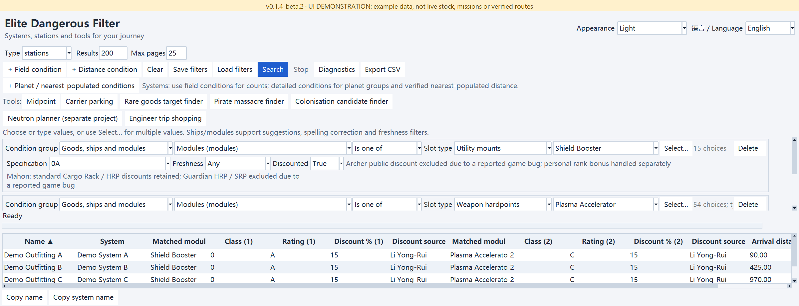

<details>
<summary>Planet / ring groups and nearest-populated-system conditions</summary>

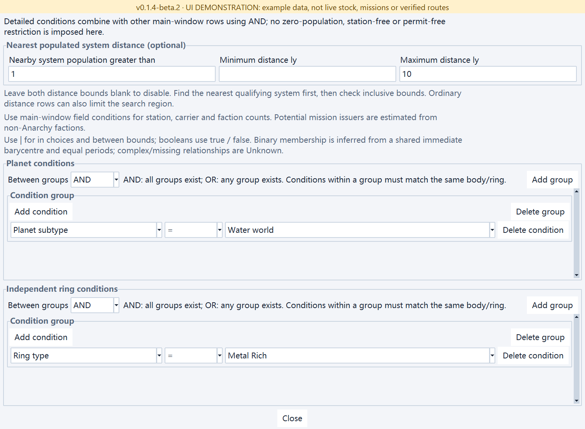

</details>

### Rare goods target finder

Source selection, Power filtering and the optional experimental neutron-alignment controls, with system-level grouping and reference-neutron columns.

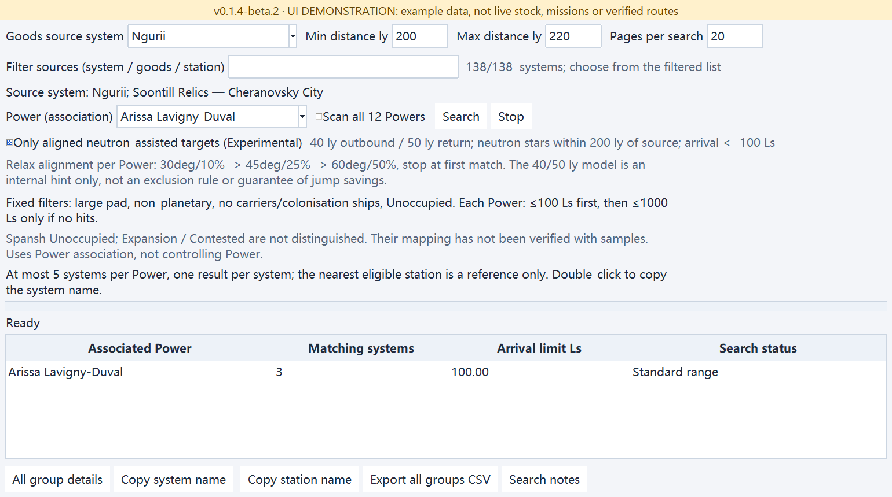

### Pirate massacre finder (testing)

Two views of the same query: the result overview, followed by the table scrolled right to show the matching source station and target ring distances.

**Result overview**

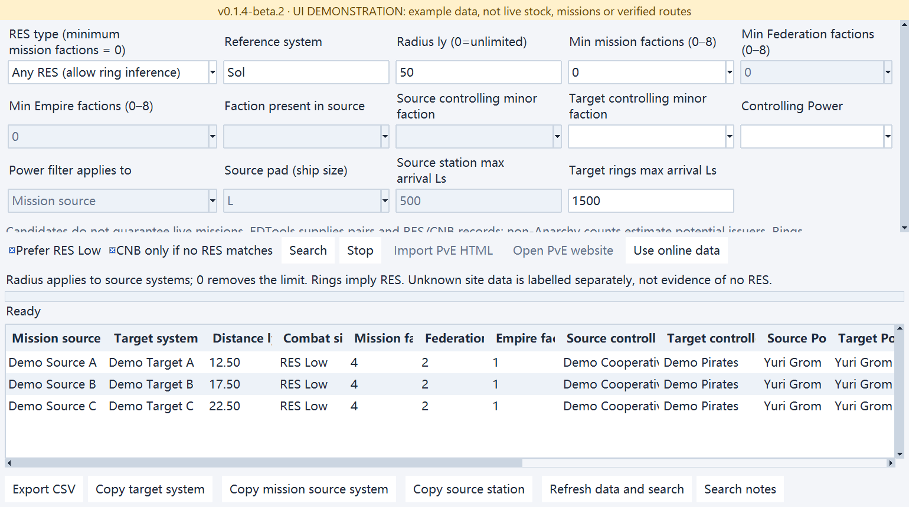

**Station and ring distance details**

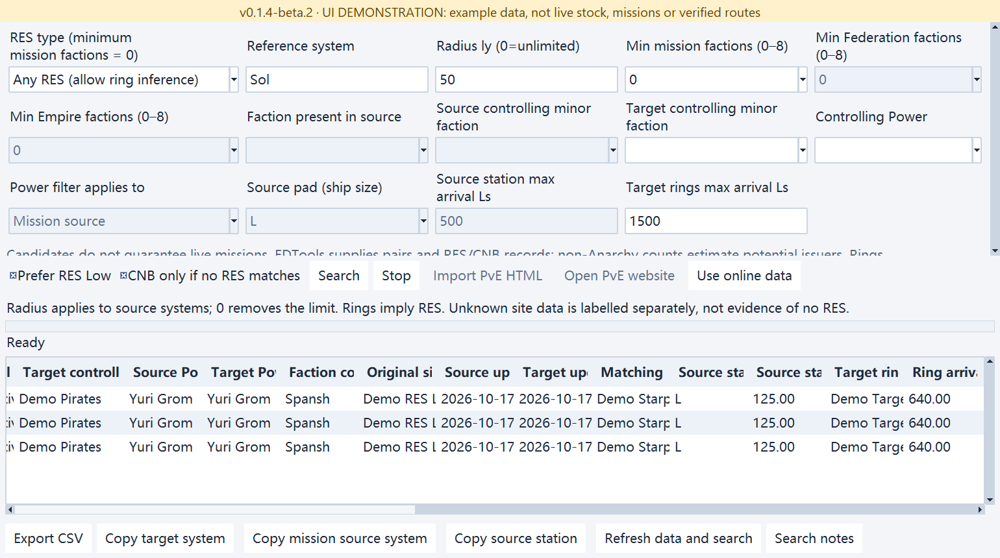

### Carrier parking finder

The current carrier-count minimum/maximum filters and sortable recorded counts, replacing the obsolete parking estimates. Counts are not live vacancies.

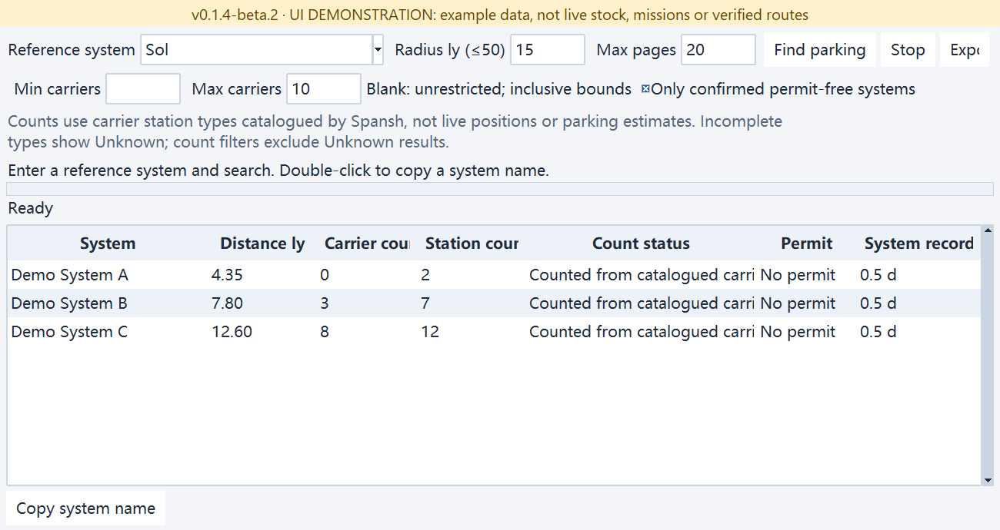

### System midpoint finder

Midpoint-search configuration and example distance columns for the midpoint and both endpoints.

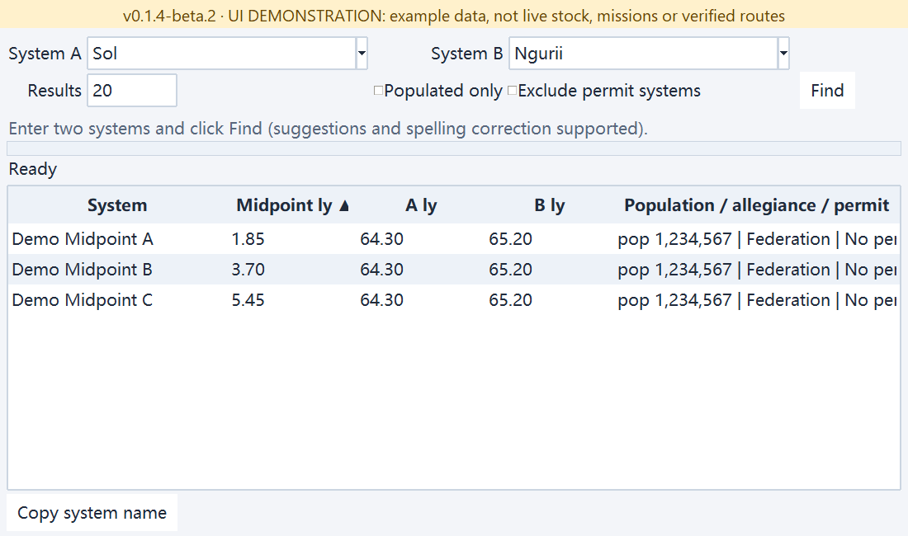

### Colonisation candidate finder

Independent regional/nearest-populated distance filters, planet groups, top scan-value planets and nearest-system information.

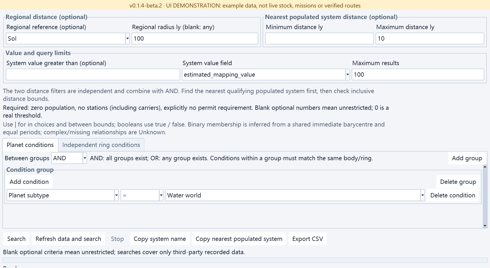

<details>
<summary>Result columns scrolled right: value and matching-body evidence</summary>

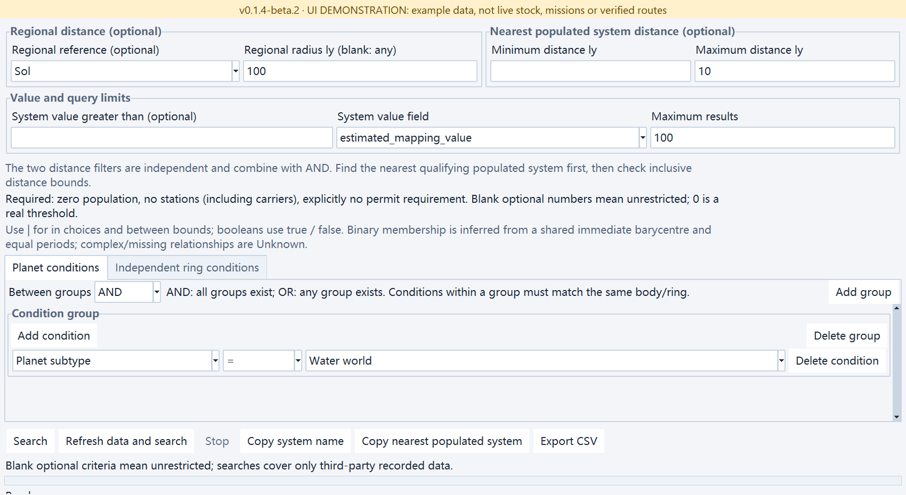

</details>

### Engineer trip shopping

Multiple independently specified shopping items, engineer selection, custom range, extra-jump limit, carrier/planetary exclusions and per-item discount evidence.

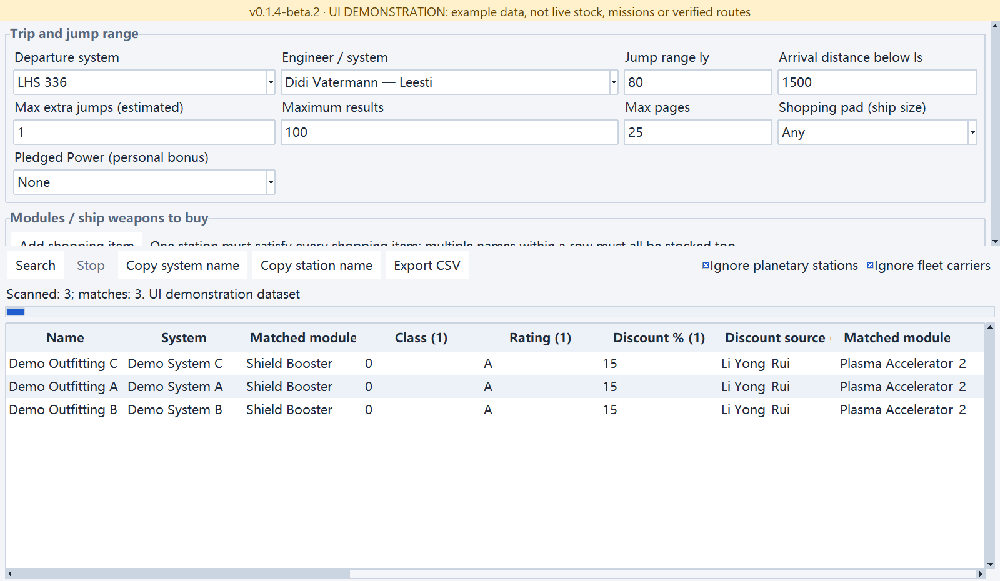

<details>
<summary>Result columns scrolled right: distances, estimated jumps and detours</summary>

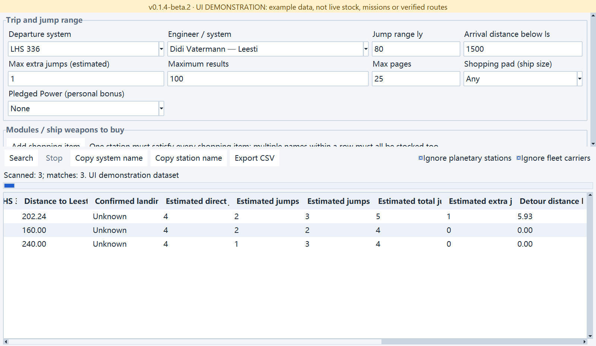

</details>

Screenshot refreshes are reproducible on Windows with optional developer dependency **Pillow 12**: `python scripts/capture_screenshots.py`. The script blocks network access, isolates sessions and records version/dimensions/checksums in [screenshots.json](docs/images/screenshots.json); Pillow is not required to run the application.

The gallery shows the UI-refactor Beta, not the older stable EXE. Each release provides its own `SHA256SUMS.txt`; passing checks does not rule out potential Beta bugs.

## CSV exports and provenance

All CSV exports start with five `# `-prefixed provenance rows: GitHub project author (`kxdxzr`), project name, application version (**0.1.4-beta.2** in this Beta), timezone-aware export time and project URL. A blank row follows, then the result header and data. Labels follow the UI language; English exports use English labels. Main-window CSV columns follow the completed search conditions instead of exporting raw JSON. CSV readers must skip the five provenance rows and blank separator. Metadata identifies the software, not ownership of upstream game data; existing CSV files are not modified.

## Data sources

- [Spansh](https://spansh.co.uk/): systems, stations, factions and full body data.
- [EDSM](https://www.edsm.net/): reference-system coordinates.
- [EDTools / CMDR VicTic](https://edtools.cc/pve.php): source/target pairs and explicit RES/CNB records, not a live mission API.
- [Inara](https://inara.cz/elite/): reference for the rare-goods target template.

## License

Copyright (c) 2026 kxdxzr. Starting with the commit introducing this notice, this project's own code and documentation are licensed under the [GNU General Public License, version 3 only](LICENSE) (`GPL-3.0-only`). Commercial use is permitted; redistribution of covered binaries or modified versions must comply with the GPL, including providing the Corresponding Source and preserving required notices. This program is provided without any warranty; see LICENSE for the full terms.

This change does not revoke MIT permissions previously granted for copies published under MIT (including repository commits `afe84c4` and `2393198`). Existing release tags and EXE assets have not been replaced or retroactively relicensed. Third-party code, game data and API content remain subject to their respective licences and terms; this notice does not relicense them.

Community project, not affiliated with Frontier Developments.
