# Elite Dangerous Filter

English · [简体中文](README_zh-CN.md) · [Releases](https://github.com/kxdxzr/Elite_dangerous_Filter/releases)

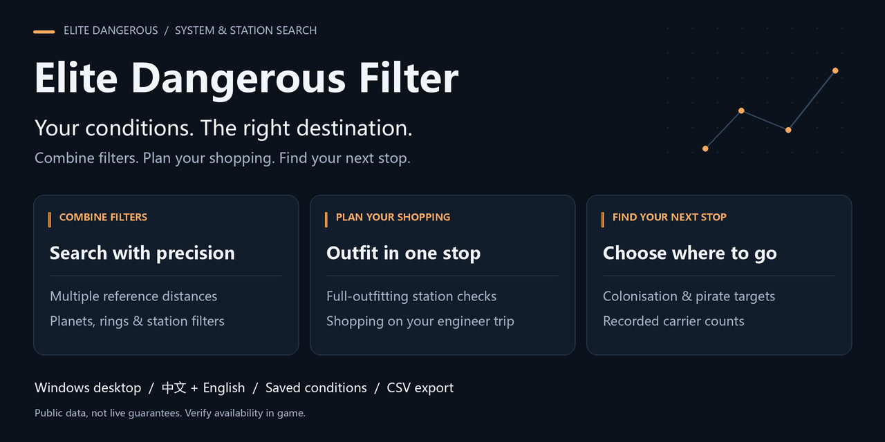

**Your conditions. The right destination.** A desktop tool for finding Elite Dangerous systems and stations using [Spansh](https://spansh.co.uk/) and other public data.

Combine distance and planet filters, find a station for your equipment list, or shortlist your next colony or pirate-hunting location. Chinese / English switching, System / Light / Dark appearance, saved conditions and CSV export are built in. A complement to Inara and Spansh, not a replacement for every companion tool.

## Download and quick start

> **Revision in local preparation: v0.1.4-r1** ([draft notes](docs/releases/v0.1.4-r1.md)). Not published yet; the download below remains the original v0.1.4. Do not expect the revision's changes in that EXE.

[**Download Windows x64 EXE v0.1.4**](https://github.com/kxdxzr/Elite_dangerous_Filter/releases/download/v0.1.4/EliteDangerousFilter.exe) · [Release notes](docs/releases/v0.1.4.md) · [All releases and source packages](https://github.com/kxdxzr/Elite_dangerous_Filter/releases)

1. Download `EliteDangerousFilter.exe`. No Python installation or API key required.
2. Launch it: search systems/stations in the main window, or open a tool under **Extra tools**.
3. Add conditions and search. Click result headers to sort; copy names, export CSV, save conditions and restore sessions.

Online searches and updates require internet. Saved full-outfitting stock can be filtered locally; missing reference-system coordinates still require a lookup.

**Back up `%LOCALAPPDATA%\EliteDangerousFilter` before upgrading.** Beta and stable share this directory; keep the old EXE and backup for rollback.

The EXE is **not code-signed**; Windows may show Unknown publisher or SmartScreen warnings. Confirm the download came from this project's release page, then compare its hash with that release's `SHA256SUMS.txt`. Hash checking is not publisher-signature verification or a safety guarantee.

```powershell
certutil -hashfile EliteDangerousFilter.exe SHA256
```

> Source and published assets can differ. Same-station groups in system searches and separate non-carrier/orbital/planetary station counts are **source-only additions**, not in the linked v0.1.4 EXE. The original release assets have not been replaced; current source also embeds Windows file/product version resources.

## What can you do with it?

### Combine filters instead of checking each requirement by hand

- **Search around more than one system.** Combine reference distances, intersections and outside ranges with station facilities, economy, factions and record freshness.
- **Match the equipment you actually need.** Filter module specifications using confirmed class/rating pairs, not invented combinations.
- **Look for particular systems.** Combine planet and independent ring groups, station/faction counts and verified nearest-populated distance.

For example: find a station selling a specified module within range of two reference systems, with a large landing pad and a short arrival distance. Separate rows use AND; choices within one multi-select row use OR.

<details>
<summary>See the main filter and system-detail editor</summary>

Screenshots here and below were captured on 2026-10-20 from v0.1.4 in Light appearance. Yellow banners mark **offline illustrative fixtures**, not actual stock, missions, claimable systems or verified routes. They do not show later source-only additions.

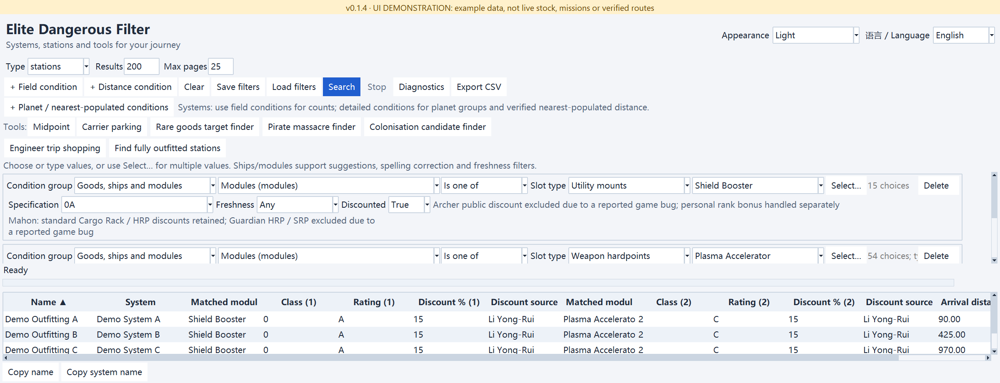

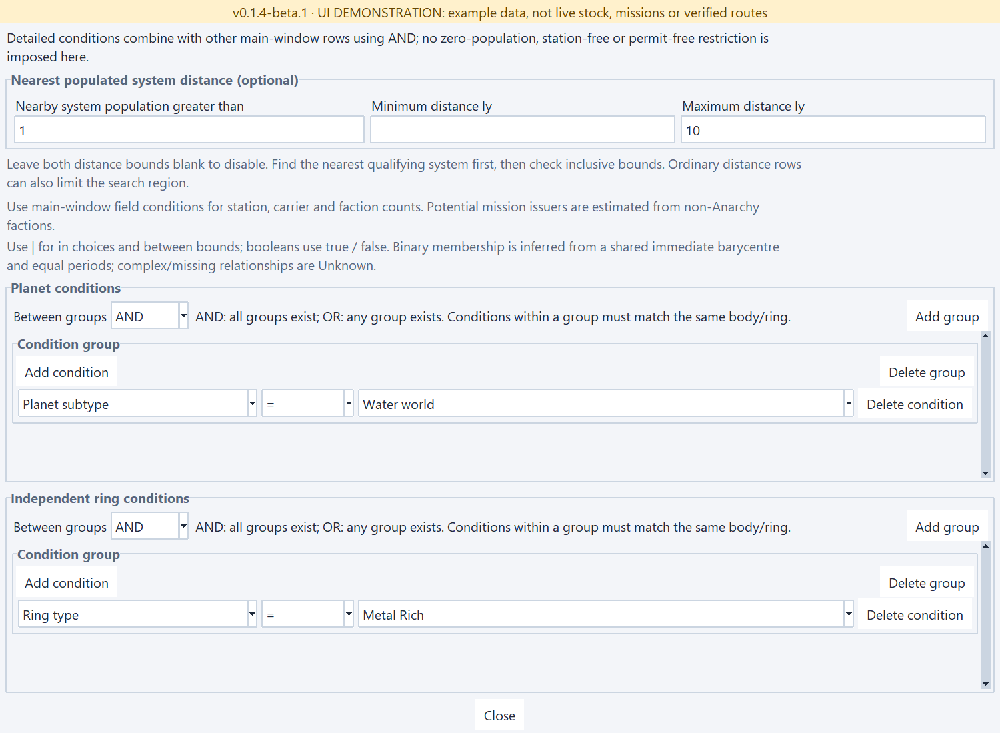

</details>

### Buy your equipment with fewer stops

- **Find fully outfitted stations.** Check actual same-station stock against the known catalogue, with optional discounts, AX, Universal controllers, Merc, ships/armour and Guardian broker requirements. Carriers and Stronghold Carriers are excluded.
- **Shop on the way to an engineer.** Give each item its own specification and find one station stocking **every item** on your trip to one of 25 ship engineers. Compare landing pads, arrival distance, freshness, discounts and estimated extra jumps.

Unlike a multi-select OR filter, the shopping list requires all requested items at the same station. Unknown data never counts as confirmed stock; ambiguous Merc identities can prevent a strict match.

<details>
<summary>See full-outfitting checks and engineer shopping (offline demonstrations)</summary>

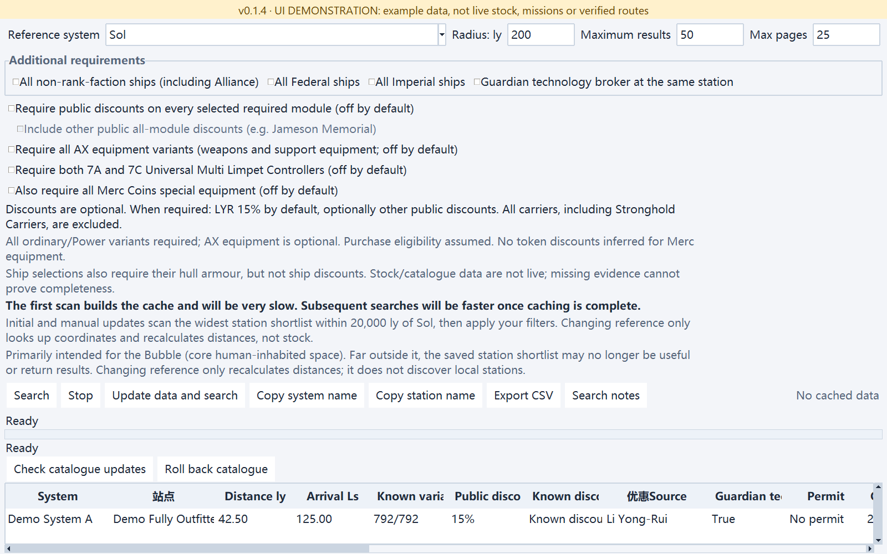

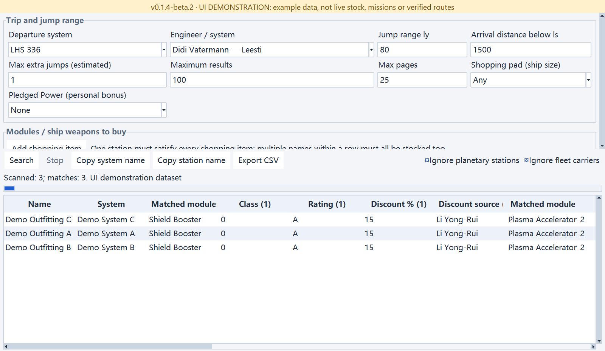

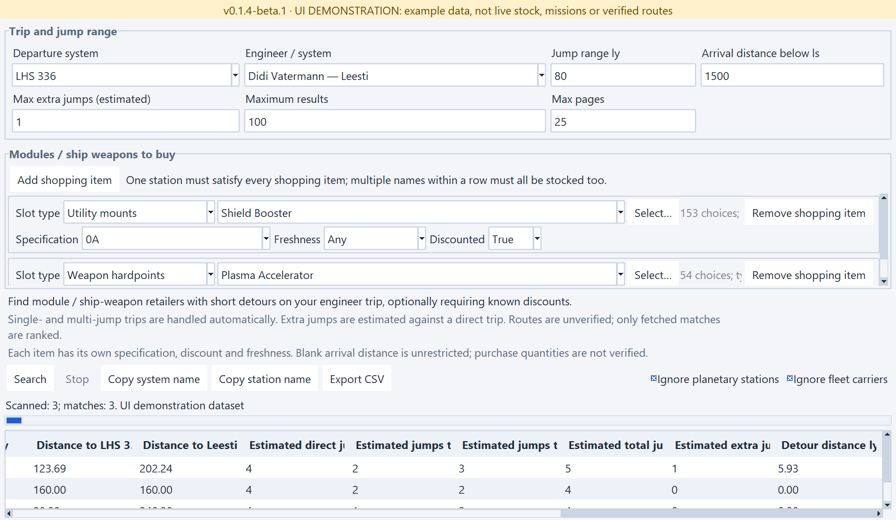

</details>

### Choose a destination for your next activity

- **Colonisation candidates:** shortlist zero-population, explicitly permit-free, station-free systems by region, nearby populated space, value, planets and rings. A candidate is not a guarantee that the system is claimable.
- **Pirate hunting (testing):** combine EDTools mission pairs and site records with Spansh factions, controlling Power, source-station access and target rings. Set the minimum mission-faction count to 0 to also search for RES systems outside the mission-pair catalogue. This is not a live mission board.

| Also included | What it helps you find |
| --- | --- |
| Rare goods targets | Targets for 142 source entries across 138 systems, grouped by system and filtered by associated Power; optional experimental neutron-alignment filtering |
| Carrier parking reference | Systems within up to 50 ly matching a maximum recorded carrier count; **not live vacant slots** |
| System midpoint | Systems near the geometric midpoint of two references, with distances to both endpoints |

<details>
<summary>See colonisation, pirate hunting and the other tools (offline demonstrations)</summary>

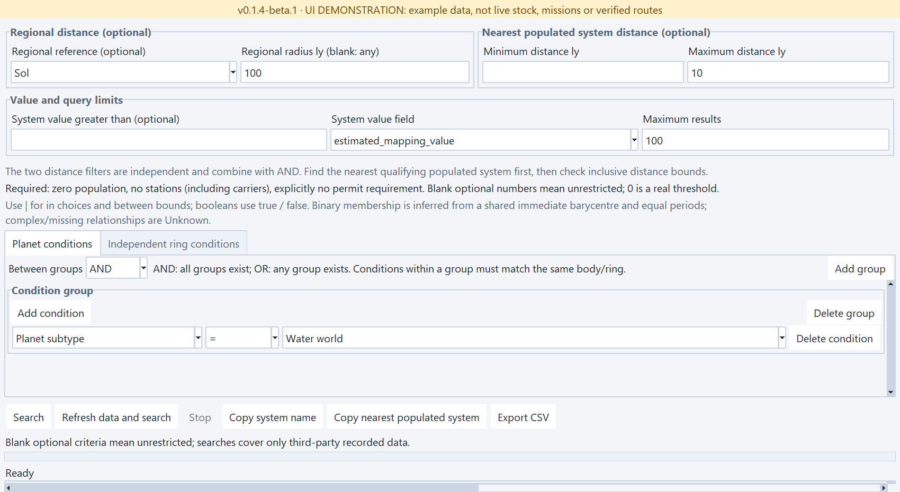

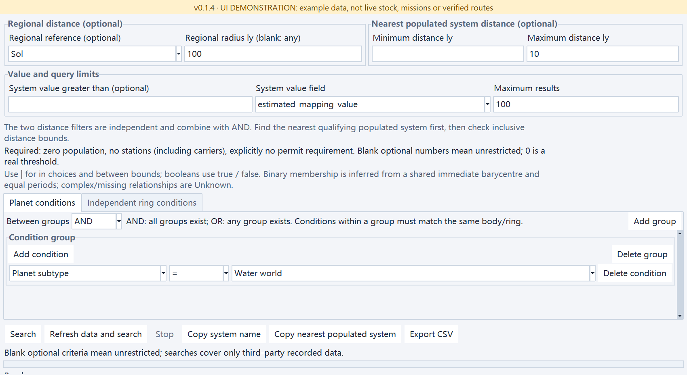

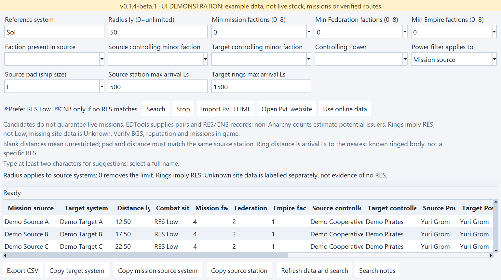

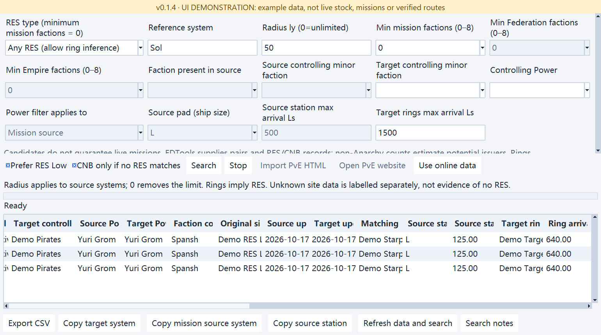

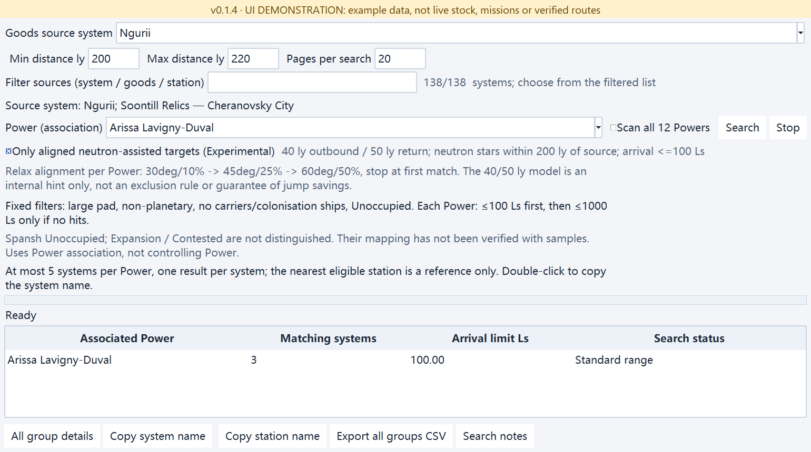

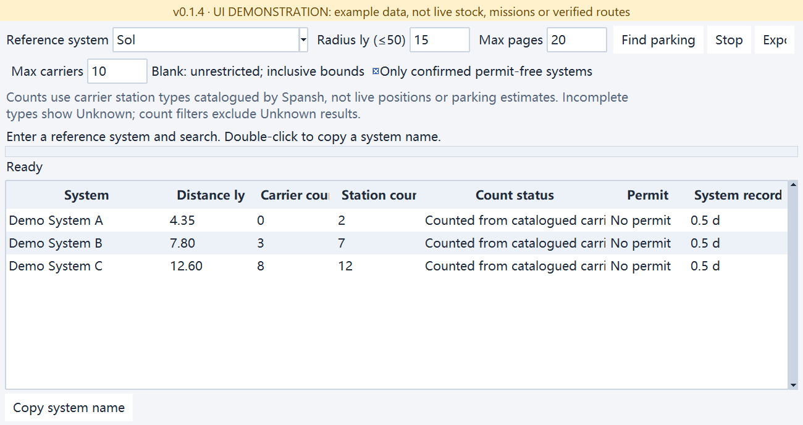

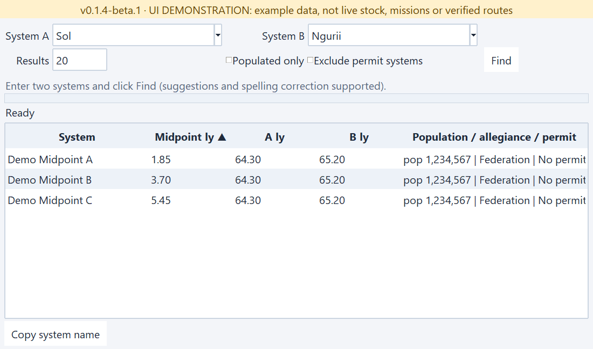

</details>

## Know what the results mean

### Full-outfitting scope and first scan

- **The first scan is slow: minutes to more than ten minutes are possible.** Initial/manual discovery uses the widest shortlist within **20,000 ly of Sol**, primarily useful around the Bubble.
- Subsequent conditions reuse local stock. Changing reference only retrieves missing coordinates and recalculates distances. Increasing radius does not discover stations outside the shortlist; results far from the Bubble may be unsuitable or empty.
- Discounts, AX, 7A/7C Universal multi-limpet controllers and Merc are off by default. Merc identity remains ambiguous; strict searches may return no hits rather than accept guesses.
- Successful refreshes atomically replace the same snapshot; failures retain old data. Stock is not live; the UI displays cache age.
- Catalogue and stock are separate: manual GitHub catalogue updates/rollback are supported, but **no catalogue release has been published yet**. Refresh stock manually to apply a changed catalogue.
- Completeness is relative to the current catalogue and selected options. Explicit hangar/vehicle-bay exclusions are recorded in the [tool guide](docs/full-outfitting.md) and [catalogue roadmap](docs/catalog-next-version.md).

See [full usage and validation](docs/full-outfitting.md) and [catalogue updates/rollback](docs/catalog-updates.md) (Chinese).

### Important distinctions

- **Discounts:** general filters use documented public rules, not associated-Power guesses. Engineer shopping separately labels a maximum-rank personal weapon-discount assumption when a Power is selected; actual rank is not read. Select None for public-only discounts. No stacking. See [discount rules](docs/station-discounts.md) and [engineer shopping](docs/engineer-shopping.md).
- **Distances:** pirate mission-pair radius applies to the source; additional RES-system rows use the target. Radius `0` means unlimited. Station/ring maximum Ls is unlimited only when blank; `0` is an actual 0 Ls bound. See [search logic](docs/README_search_logic.md).
- **Estimates are not routes:** engineer extra jumps are estimates; rare-goods neutron alignment checks geometry, not fuel, landing systems or actual jump savings.
- **Colonisation limitation:** the current station-free check still includes ordinary carriers, excluding carrier-only systems. Construction-slot counts are unsupported. Nearest-populated defaults to population >1; both distance bounds apply to the same nearest qualifying system.
- **Neutron planner moved:** use [Elite_dangerous_Neutron_Planner](https://github.com/kxdxzr/Elite_dangerous_Neutron_Planner) for full routing. It is no longer bundled here. Old `route_ship_favorites.json` files can be imported manually there; rare-goods geometric filtering remains here.

## Data, sessions and exports

- **Data is neither guaranteed live nor galaxy-complete.** Verify stock, permits, discounts, missions, vacancies and colonisation eligibility in game. Faction counts only estimate potential issuers; rings do not establish a specific RES type.
- Page/server limits, missing data, request failures or cancellation can leave searches incomplete. No results does not prove absence in game. Percentages refer only to the labelled stage.
- Rare goods uses associated Power. Mapping Spansh `Unoccupied` to Inara Unoccupied/Expansion/Contested is unverified; the latter two cannot be filtered separately.
- Changes save every 1.5 seconds and on close, including language, appearance, condition drafts and seven tools' settings. Writes are atomic; failed close-time saves display an error and keep the window open.
- EXE data: `%LOCALAPPDATA%\EliteDangerousFilter\`. Source runs use project `data/` and `cache/`. `ELITE_FILTER_DATA_DIR` overrides both for isolation. `scripts/migrate_data.py` migrates legacy files without overwriting existing destinations.
- CSV begins with five `# ` provenance rows: author, project name, running version, timezone-aware export time and project URL. Some exports, including full outfitting, add search conditions, followed by a blank row, result header and data. **Do not hard-code skipping six lines: locate the separator/result header after metadata.**
- CSV reflects the completed search, not edited-but-unsubmitted drafts. Main-window exports use condition-driven columns instead of full raw JSON. Provenance identifies the software, not ownership of third-party game data.

## Run from source and build

Requires **Python 3.10+ and tkinter**, with no third-party runtime dependencies. Check Tk with `python -m tkinter`; Debian/Ubuntu may require `python3-tk`.

```sh
git clone https://github.com/kxdxzr/Elite_dangerous_Filter.git
cd Elite_dangerous_Filter
python filter_gui.py
```

Run tests and build the Windows EXE from the project directory:

```sh
python scripts/run_tests.py
python -m compileall -q src tests scripts filter_gui.py spansh_filter.py
python -m pip install -r requirements-build.txt
python -m PyInstaller --noconfirm --clean EliteDangerousFilter.spec
```

Default output: **`dist/EliteDangerousFilter.exe`** inside the project. Application identity and version live in `src/app_metadata.py`; the build derives Windows version resources from the same data used by CSV exports. Version resources are not code signatures.

The actual EXE supports `--smoke-test <report.json>`, `--session-test write <report.json>` and `--session-test read <another-report.json>`. Run session write/read in separate processes with an isolated `ELITE_FILTER_DATA_DIR`; create report directories first to avoid touching personal sessions. Tk tests require a graphical display. CI covers Windows/Ubuntu and Python 3.10/3.13.

Implementation is in `src/`, tests in `tests/`, helpers in `scripts/` and sample conditions in `examples/`. CLI usage: `python spansh_filter.py --help` and the [filter guide](docs/README_筛选器说明.txt) (Chinese). Refresh screenshots with `scripts/capture_screenshots.py` and optional developer dependency Pillow 12; it isolates sessions, blocks network access and records dimensions/hashes in the [manifest](docs/images/screenshots.json).

Regenerate the feature covers with `python scripts/render_feature_cover.py` (Pillow and a CJK-capable font required). It produces the English `docs/social-preview.png` and Chinese `docs/social-preview-zh.png`, without network access or application data. README images use these files; the repository's GitHub social-preview setting must be updated separately by uploading the chosen image.

## Documentation and sources

- [Detailed search logic](docs/README_search_logic.md) · [Full outfitting](docs/full-outfitting.md) · [Engineer shopping](docs/engineer-shopping.md) · [Discount rules](docs/station-discounts.md)
- [Language-pack structure and extension guide](docs/localization.md) (Chinese; currently Chinese/English only)
- [v0.1.4 release notes](docs/releases/v0.1.4.md) · [Release history](https://github.com/kxdxzr/Elite_dangerous_Filter/releases)
- Developing other ED tools: [shareable public data/API reference](docs/ed-public-data-api-reference.md) · [complete API development reference](docs/ed-api-reference.md) (Chinese)
- [Spansh](https://spansh.co.uk/): systems, stations, factions and bodies. [EDSM](https://www.edsm.net/): coordinates and same-market outfitting identity evidence.
- [EDTools / CMDR VicTic](https://edtools.cc/pve.php): mission pairs and explicit RES/CNB records, not a live mission API. [Inara](https://inara.cz/elite/): rare-goods target-template reference.

## License and credits

Copyright (c) 2026 kxdxzr. Project-owned code and documentation are [GPL-3.0-only](LICENSE) from the licence-change notice commit onward. Commercial use is permitted; redistribution must meet corresponding-source, notice and other GPL obligations. No warranty. Previously granted MIT permissions remain valid (including commits `afe84c4` and `2393198`); historical versions are not retroactively relicensed. Third-party code, data and services retain their respective terms.

Developed by **GPT-6.1 Sol** through **vibe coding**, with user-driven iteration. Community project; not affiliated with Frontier Developments.
