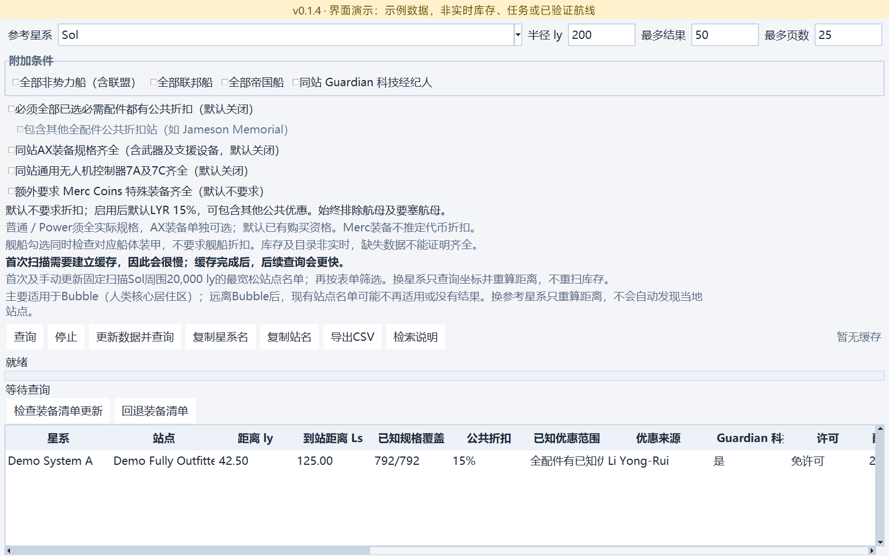

# Elite_dangerous_Filter

[English](README.md) · 简体中文 · [发行版本](https://github.com/kxdxzr/Elite_dangerous_Filter/releases)

Elite Dangerous 星系与空间站筛选桌面工具，基于 [Spansh](https://spansh.co.uk/) 等公开数据，支持即时中英文切换，以及跟随系统／浅色／深色外观。

**适合组合复杂条件查询**：多参考点距离、模组实际规格、同站完整采购清单、折扣、天体与星环等。不一定比 Inara 更适合简单查询，定位是补充而不是替代。

## 下载与快速开始

[**下载 Windows x64 EXE v0.1.4**](https://github.com/kxdxzr/Elite_dangerous_Filter/releases/download/v0.1.4/EliteDangerousFilter.exe) · [发布说明](docs/releases/v0.1.4.md) · [全部版本与源码包](https://github.com/kxdxzr/Elite_dangerous_Filter/releases)

1. 下载 `EliteDangerousFilter.exe`，无需安装 Python，无需 API key。
2. 双击运行；主界面查询星系／空间站，其他工具在 **额外功能** 中打开。
3. 添加条件并查询，点击结果表头排序；可复制名称、导出 CSV、保存条件和恢复会话。

联网查询和更新需要网络；已有满配件库存快照可本地筛选，缺少参考星系坐标时仍需联网。

**升级前备份 `%LOCALAPPDATA%\EliteDangerousFilter`。** Beta 与正式版共用数据目录；保留旧 EXE 和备份以便回退。

EXE **未做代码签名**，Windows 可能提示“未知发布者”或 SmartScreen 警告。先确认下载自本项目发行页，再与同页 `SHA256SUMS.txt` 核对；哈希校验不是发布者数字签名，也不保证软件绝对安全。

```powershell
certutil -hashfile EliteDangerousFilter.exe SHA256
```

> 源码分支与已发布附件不一定完全一致：当前源码及本地重打包版已补充 Windows 文件／产品版本资源，GitHub v0.1.4 原附件尚未替换。

## 工具概览

| 工具 | 用途与关键规则 |
| --- | --- |
| 主界面通用筛选 | 星系／站点条件自由组合：不同行 AND，同一行多选 OR；支持多参考点、距离交集／范围外、同件模组规格、新鲜度、站点／派系数量及天体／星环组 |
| 查找满配件空间站 | 按已知目录逐项核验同站普通／Power 配件规格，可选折扣、AX、通用控制器、Merc、舰船／装甲及 Guardian 经纪人；排除航母和要塞航母 |
| 工程师途中采购 | 向 25 位舰船工程师出发途中，寻找一座满足全部采购项的站点；每项独立规格、折扣与新鲜度，支持停机坪、到站距离和额外估算跳数 |
| 稀有商品目标查找 | 142 个来源条目、138 个星系；按关联 Power 筛选，按星系合并目标，可选实验性中子星几何顺路筛选 |
| 海盗任务查找（测试中） | EDTools 任务配对／地点记录结合 Spansh 派系、控制 Power、来源站和目标星环条件；最少任务派系数为 0 时扩展 RES 星系检索 |
| 航母车位查找 | 最多 50 ly，按已收录航母数量筛选；仅设最多航母数，数量不是实时空位 |
| 两系中点 | 查找两星系几何中点附近星系，展示距中点及两端距离 |
| 殖民候选星系查找 | 零人口、明确免许可、无站点候选；支持区域、最近有人距离、价值、星球与独立星环条件，不保证实际可认领 |

模组建议保留已确认的等级／级别组合，不拼接不存在的规格。主界面的 OR 与采购清单“全部采购项都要满足”不同；未知值不会当作已确认满足条件。

### 查找满配件空间站

- **首次扫描会很慢，可能数分钟到十多分钟。** 首次及手动更新固定采集 Sol 周围 **20,000 ly** 最宽松站点名单，主要适用于 Bubble。
- 后续改条件复用本地库存；换参考星系仅补查缺少的坐标并重算距离。扩大半径不会自动发现名单外站点，远离 Bubble 可能无有效结果。
- 折扣、AX、通用多功能无人机控制器 7A／7C 和 Merc 默认不要求。Merc 身份仍有歧义，严格条件可能零命中，不会按猜测放行。
- 快照成功更新后原位覆盖；失败保留旧数据。库存不是实时数据，界面显示缓存年龄。
- 装备目录与库存是两套数据：支持手动 GitHub 清单更新／回退，但**首份清单 Release 尚未发布**；更新目录后还需手动刷新库存才应用新目录。
- “满配件”相对于当前目录及勾选条件；机库／车库等明确排除项见[工具说明](docs/full-outfitting.md)和[后续清单计划](docs/catalog-next-version.md)。

详见：[完整用法与验证记录](docs/full-outfitting.md) · [清单更新及回退](docs/catalog-updates.md)。

### 使用时需要区分

- **折扣**：普通筛选按已知公共规则判断，不凭关联 Power 推定。工程师采购选择 Power 后另行明示适用武器的满级个人优惠假设，未读取玩家实际等级；选择“无”只算公共优惠。不叠加折扣。详见[折扣规则](docs/station-discounts.md)和[工程师采购](docs/engineer-shopping.md)。
- **距离**：海盗任务配对的半径针对来源；扩展 RES 星系行针对目标。半径 `0` 为不限，站点／星环最大 Ls 留空才不限，填 `0` 是实际 0 Ls 上限。完整规则见[检索逻辑](docs/README_检索逻辑.md)。
- **估算不等于路线**：工程师额外跳数只是估算；稀有商品中子顺路筛选只检查几何关系，不验证燃油、落点或实际省跳。
- **殖民限制**：当前无站点检查仍包含普通航母，会排除只有航母的星系；不支持建设槽位数量筛选。最近有人默认人口 >1，最近距离上下限针对同一个最近达标星系。
- **中子规划器已拆分**：完整航线规划请使用 [Elite_dangerous_Neutron_Planner](https://github.com/kxdxzr/Elite_dangerous_Neutron_Planner)。本 EXE 不再内置；旧 `route_ship_favorites.json` 可手动导入独立版。稀有商品几何筛选仍保留。

## 数据、会话与导出

- **数据不保证实时或穷尽银河。** 库存、许可、折扣、任务、空位和殖民资格都需在游戏内核实。派系数量只是潜在任务发布者估计；星环不能证明具体 RES 类型。
- 页数／服务端上限、数据缺失、请求失败或停止可能导致未完成；“无结果”不代表游戏内不存在。进度百分比仅对应标注的当前阶段。
- 稀有商品使用关联 Power；Spansh `Unoccupied` 与 Inara Unoccupied／Expansion／Contested 的合并对应关系未经样本验证，后两者不能独立筛选。
- 变更每 1.5 秒及关窗时保存，保留语言、外观、条件草稿和七个工具设置；原子写入，关窗保存失败时提示并保留窗口。
- EXE 数据在 `%LOCALAPPDATA%\EliteDangerousFilter\`；源码运行使用项目 `data/` 与 `cache/`。`ELITE_FILTER_DATA_DIR` 可统一指定隔离目录。旧数据可用 `scripts/migrate_data.py` 迁移，已有目标不覆盖。
- CSV 开头为五行 `# `来源信息：作者、项目名、运行版本、含时区导出时间、项目链接。部分导出（如满配件工具）还附检索条件，随后为空行、表头和结果；**导入时不要固定跳过六行，应定位元信息后的空行／结果表头**。
- CSV 保留已完成搜索的条件，而不是尚未重新查询的界面草稿；主界面按条件拆列，不导出整份原始 JSON。来源信息标识软件，不代表拥有第三方游戏数据版权。

## 截图

2026-10-20 拍摄于 v0.1.4 浅色界面，覆盖主界面及七个工具。全部为带黄色提示的**离线演示数据**，不是实际库存、任务、可认领星系或已验证路线。点击图片可查看原尺寸。

### 主界面


<details>
<summary>天体／独立星环组与最近有人条件</summary>


</details>

### 查找满配件空间站



### 工程师途中采购


<details>
<summary>距离、估算跳数及绕行明细</summary>


</details>

### 稀有商品目标查找


### 海盗任务查找（测试中）


<details>
<summary>来源站点及目标星环距离明细</summary>


</details>

### 航母车位查找

最多航母数量与记录统计，不代表实时空位。


### 两系中点


### 殖民候选星系查找


<details>
<summary>价值及天体匹配明细</summary>


</details>

## 源码运行与构建

源码需要 **Python 3.10+ 和 tkinter**，无第三方运行依赖。`python -m tkinter` 可检查 Tk；Debian／Ubuntu 可能需要安装 `python3-tk`。

```sh
git clone https://github.com/kxdxzr/Elite_dangerous_Filter.git
cd Elite_dangerous_Filter
python filter_gui.py
```

在项目目录执行测试及 Windows 打包：

```sh
python scripts/run_tests.py
python -m compileall -q src tests scripts filter_gui.py spansh_filter.py
python -m pip install -r requirements-build.txt
python -m PyInstaller --noconfirm --clean EliteDangerousFilter.spec
```

默认输出为项目下的 **`dist/EliteDangerousFilter.exe`**；Windows 版本资源在 `EliteDangerousFilter.version.txt`，需与 `src/export_metadata.py` 同步。版本资源不是代码签名。

实际 EXE 支持 `--smoke-test <报告.json>`、`--session-test write <报告.json>`、`--session-test read <另一报告.json>`；会话写入／读取须分进程运行，设置独立 `ELITE_FILTER_DATA_DIR`，提前创建报告目录，避免覆盖个人会话。Tk 测试需要图形环境；CI 覆盖 Windows／Ubuntu、Python 3.10／3.13。

实现位于 `src/`，测试在 `tests/`，脚本在 `scripts/`，条件示例在 `examples/`。CLI 用法见 `python spansh_filter.py --help` 及[筛选器说明](docs/README_筛选器说明.txt)。截图重拍使用 `scripts/capture_screenshots.py` 和可选开发依赖 Pillow 12；脚本隔离会话并禁用网络，[manifest](docs/images/screenshots.json)记录尺寸与哈希。

## 文档与数据来源

- [详细检索逻辑](docs/README_检索逻辑.md) · [满配件工具](docs/full-outfitting.md) · [工程师采购](docs/engineer-shopping.md) · [折扣规则](docs/station-discounts.md)
- [v0.1.4发布说明](docs/releases/v0.1.4.md) · [历史发行版本](https://github.com/kxdxzr/Elite_dangerous_Filter/releases)
- 开发其他 ED 工具：[公开数据源速查（可独立分享）](docs/ed-public-data-api-reference.md) · [完整 API 开发参考](docs/ed-api-reference.md)
- [Spansh](https://spansh.co.uk/)：星系、站点、派系与天体数据；[EDSM](https://www.edsm.net/)：坐标与同市场配件身份补证。
- [EDTools／CMDR VicTic](https://edtools.cc/pve.php)：任务配对与明确 RES／CNB 地点记录，非实时任务 API；[Inara](https://inara.cz/elite/)：稀有商品目标模板参考。

## 许可与致谢

Copyright (c) 2026 kxdxzr。项目自身代码及文档自许可变更声明提交起采用 [GPL-3.0-only](LICENSE)，允许商用；分发须遵守对应源码、许可声明等义务，不提供担保。此前 MIT 副本的授权不撤销（包括提交 `afe84c4`、`2393198`），历史版本未被追溯重新授权；第三方代码、数据及接口保留各自许可与条款。

项目由 **GPT-6.1 Sol** 通过 **vibe coding** 开发并随用户需求迭代。社区项目，与 Frontier Developments 无隶属关系。
