# Elite Dangerous Filter

[English](README.md) · 简体中文 · [发行版本](https://github.com/kxdxzr/Elite_dangerous_Filter/releases)

> **测试版：[v0.1.5-beta](https://github.com/kxdxzr/Elite_dangerous_Filter/releases/tag/v0.1.5-beta)** — 新增途经规划、本地可更新 EDTools 清单、HGE 候选、路线范围收紧和核实结果增量显示。[功能及限制](docs/releases/v0.1.5-beta.md)。最新正式版仍为 v0.1.4-r1。


**组合你的条件，找到合适的目的地。** 基于 [Spansh](https://spansh.co.uk/) 等公开数据的 Elite Dangerous 星系与空间站筛选桌面工具。

把距离、天体和站点条件放在一起查，找一站买齐装备的地方，或为殖民、海盗任务挑选下一站。内置中英文切换、跟随系统／浅色／深色外观、条件保存和 CSV 导出。定位是补充 Inara 和 Spansh，而不是替代所有伴随工具。

## 下载与快速开始

v0.1.5-beta 新增：[GitHub Release 检测与确认后自动替换更新](docs/release-updates.md)。Windows EXE 支持下载、SHA256 校验、保存条件后退出替换并重启，保留旧 EXE 备份；源码运行或缺少校验证据时改为打开发布页。不包含在已发布的 v0.1.4-r1 中；自动检查不提供 beta 更新。

> **v0.1.4-r1 修订版：**使用此前已打包的版本，包含中断恢复、星环／恒星筛选调整和独立支架选择。**HGE 与后来新增的“复制工程师星系名”按钮仅留在开发源码，不属于本次发行。**请先阅读[修订说明及验证限制](docs/releases/v0.1.4-r1.md)。

[**下载 Windows x64 EXE v0.1.4-r1**](https://github.com/kxdxzr/Elite_dangerous_Filter/releases/download/v0.1.4-r1/EliteDangerousFilter.exe) · [发布说明](docs/releases/v0.1.4-r1.md) · [原版 v0.1.4](https://github.com/kxdxzr/Elite_dangerous_Filter/releases/tag/v0.1.4) · [全部版本与源码包](https://github.com/kxdxzr/Elite_dangerous_Filter/releases)

1. 下载 `EliteDangerousFilter.exe`，无需安装 Python，无需 API key。
2. 双击运行；主界面查询星系／空间站，其他工具在 **额外功能** 中打开。
3. 添加条件并查询，点击结果表头排序；可复制名称、导出 CSV、保存条件和恢复会话。

联网查询和更新需要网络；已有满配件库存快照可本地筛选，缺少参考星系坐标时仍需联网。

**升级前备份 `%LOCALAPPDATA%\EliteDangerousFilter`。** Beta 与正式版共用数据目录；保留旧 EXE 和备份以便回退。

EXE **未做代码签名**，Windows 可能提示“未知发布者”或 SmartScreen 警告。先确认下载自本项目发行页，再与同页 `SHA256SUMS.txt` 核对；哈希校验不是发布者数字签名，也不保证软件绝对安全。

```powershell
certutil -hashfile EliteDangerousFilter.exe SHA256
```

> 对应 EXE 的源码请以发行标签或同页源码包为准。原版 v0.1.4 附件不替换；v0.1.4-r1 已包含同站条件组、非航母／轨道／地表站分类数量及 Windows 文件／产品版本资源。

## 可以用它做什么？

**HGE 可能星系查找器（仅开发源码，不在 v0.1.4-r1 中）：**按[材料规则](docs/hge-finder.md)核对控制派系阵营／当前状态，支持人口与星系记录时效下拉、复制星系名，不导出 CSV。不是实时信号或确定掉落查询。

### 组合条件，不再逐项人工核对

- **同时考虑多个出发点。** 把多参考点距离、交集与范围外条件，和站点设施、经济、派系、数据新鲜度一起筛选。
- **按真正需要的装备规格找站。** 模组建议保留已确认的等级／级别组合，不拼接不存在的规格。
- **查找符合偏好的星系。** 组合星球与独立星环组、站点／派系数量，以及核实后的最近有人星系距离。

例如：找一座出售指定规格模组、同时处于两个参考星系范围内、拥有大型停机坪且到站距离较短的空间站。不同行之间为 AND，同一行多选为 OR。

<details>
<summary>查看主界面与星系详细条件编辑器</summary>

本节及下文截图均于 2026-10-20 拍摄自原版 v0.1.4 浅色界面。黄色提示标明**离线演示数据**，不代表实际库存、任务、可认领星系或已验证航线，也不包含 v0.1.4-r1 的全部界面变化。

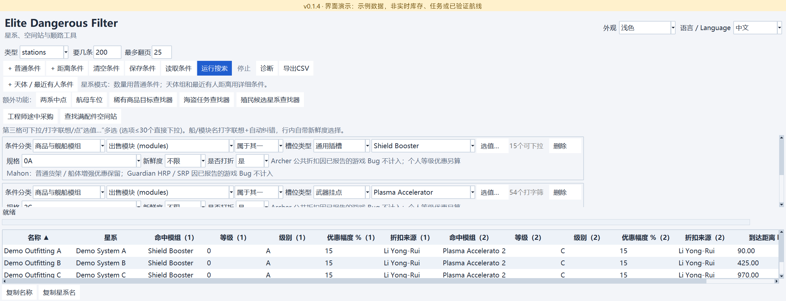

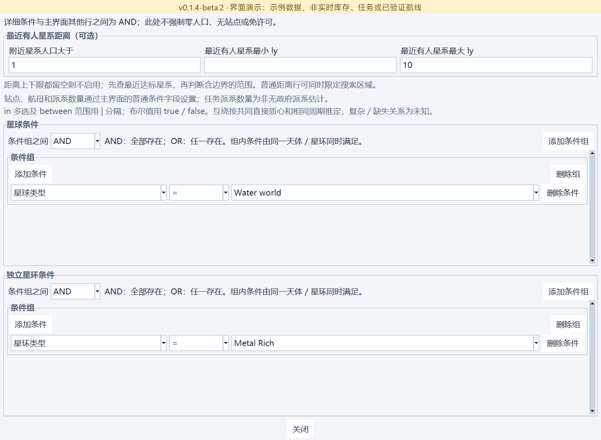

</details>

### 少跑几个站，把装备买齐

- **查找满配件空间站。** 对照已知目录逐项核验同站库存，可选择折扣、AX、通用控制器、Merc、舰船／装甲和 Guardian 经纪人要求；排除普通及要塞航母。
- **前往工程师途中采购。** 每项装备单独指定规格，寻找前往 25 位舰船工程师途中能满足**全部采购项**的一家站点，对比停机坪、到站距离、新鲜度、折扣与额外估算跳数。

与主界面多选 OR 不同，采购清单要求同一家站买齐全部所需物品。未知数据不会当作有货；Merc 身份歧义可能导致严格查询无法命中。

<details>
<summary>查看满配件核验与工程师采购（离线演示）</summary>

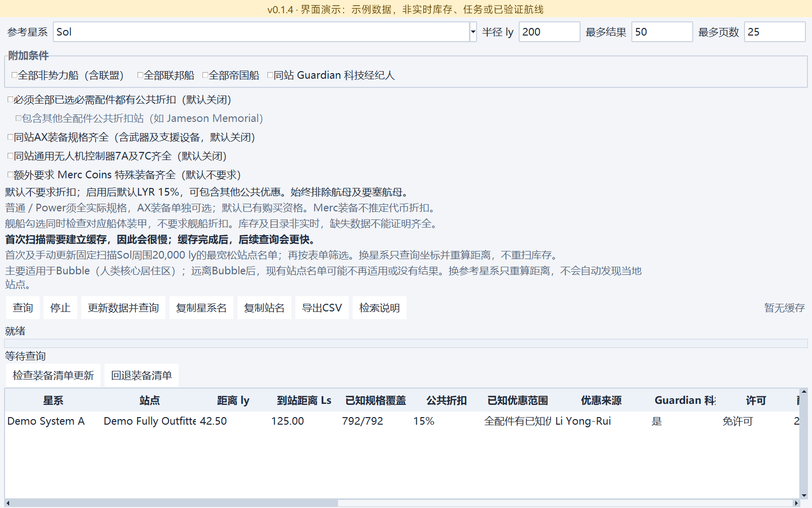

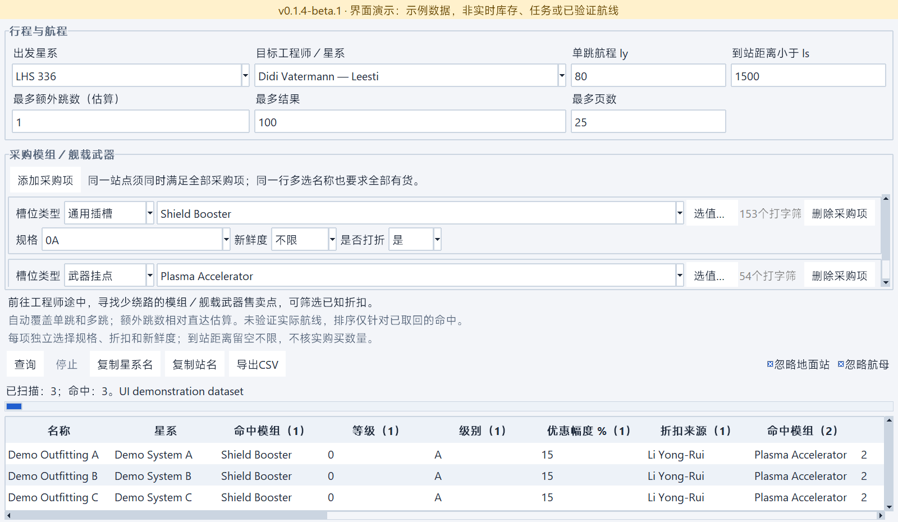

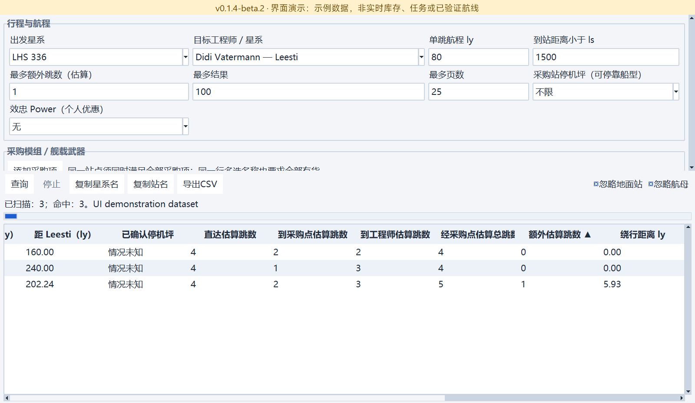

</details>

### 为下一次活动选个好去处

- **EDTools 清单（开发源码）：**内置完整配对／RES 清单，本地查询不再按小时重新下载；进入海盗工具后台检查变化，用户确认后更新，动态 BGS 资料仍单独刷新。参见[本地清单说明](docs/edtools-catalogue.md)。

- **多目标途经规划（仅开发源码）：**从主界面添加最多六组独立条件，规划 A 到 B 之间分别满足各组要求的地点。优先最少额外停靠，其次最短几何路程，支持绕路上限与同站合并。仅对本次候选集优化，不是逐跳导航。参见[用法与限制](docs/waypoint-route.md)。

- **殖民候选：**按区域、附近有人星系、价值、天体与星环，筛选零人口、明确免许可、无站点的星系。候选不等于一定可认领。
- **海盗任务选址（测试中）：**把 EDTools 任务配对与地点记录，和 Spansh 派系、控制 Power、来源站通达性及目标星环结合。最少任务派系数设为 0 时，还可检索任务配对清单以外的 RES 星系；不读取实时任务板。

| 还有这些工具 | 帮你查什么 |
| --- | --- |
| 稀有商品目标查找 | 142 个来源条目、138 个星系；按关联 Power 筛选目标并按星系分组，可选实验性中子星几何顺路筛选 |
| 航母停靠参考 | 最多 50 ly 内、满足最多已收录航母数的星系；**不是实时空余车位** |
| 两系中点 | 两个参考星系的几何中点附近星系，以及到两端的距离 |

<details>
<summary>查看殖民、海盗任务及其他工具（离线演示）</summary>

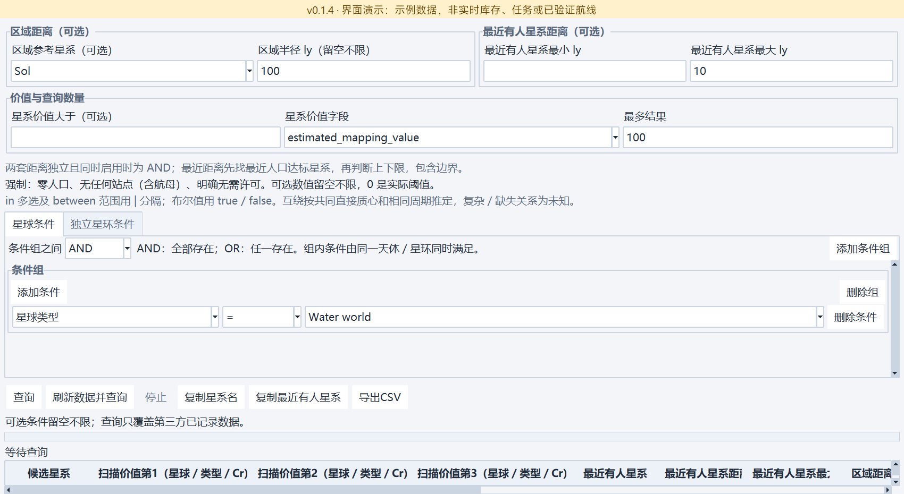

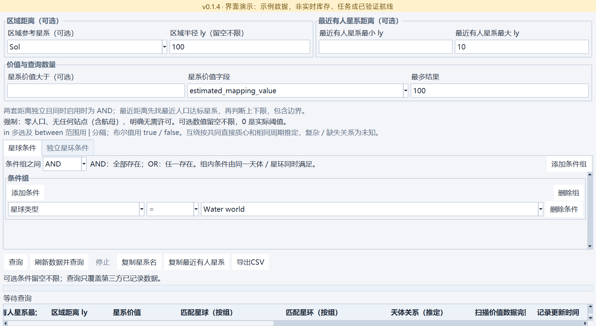

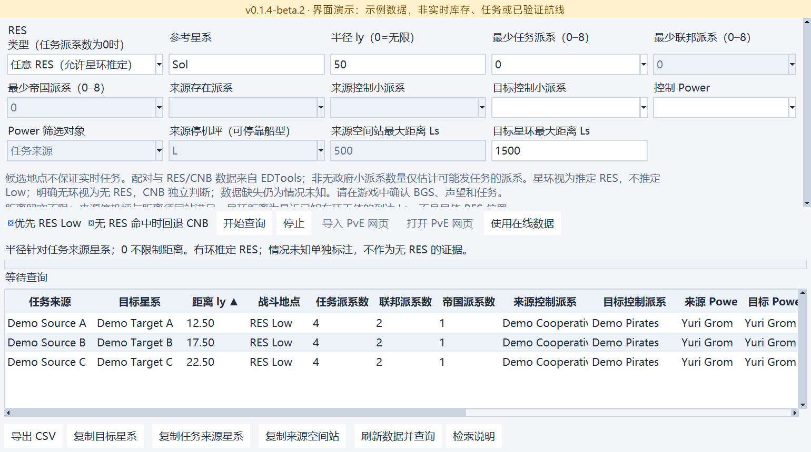

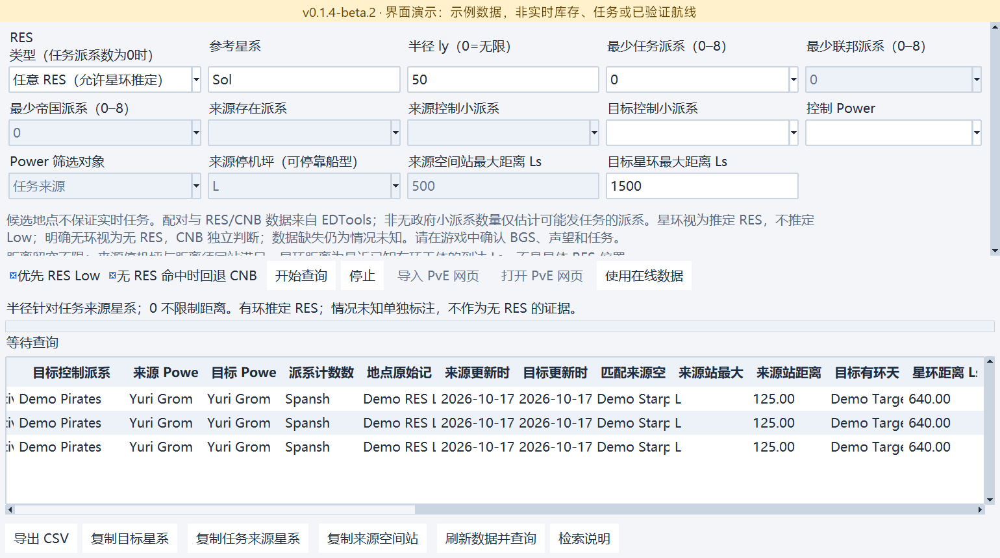

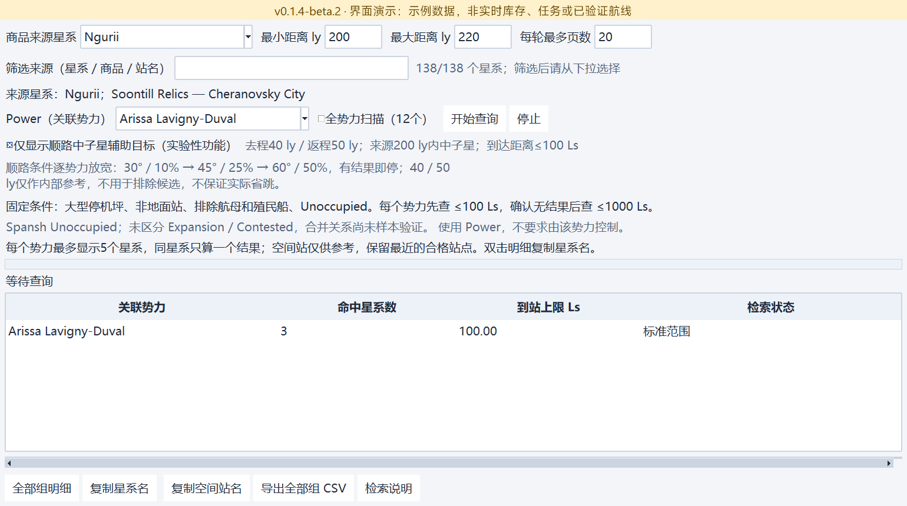

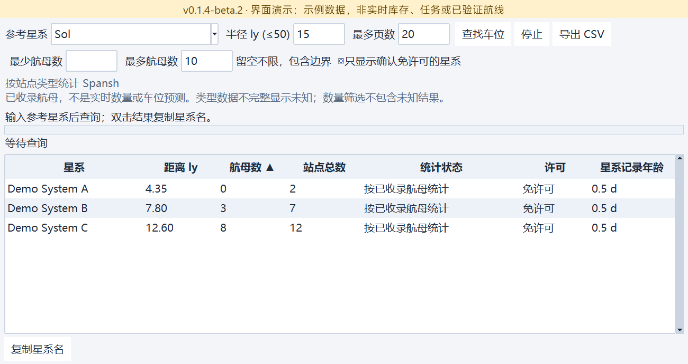

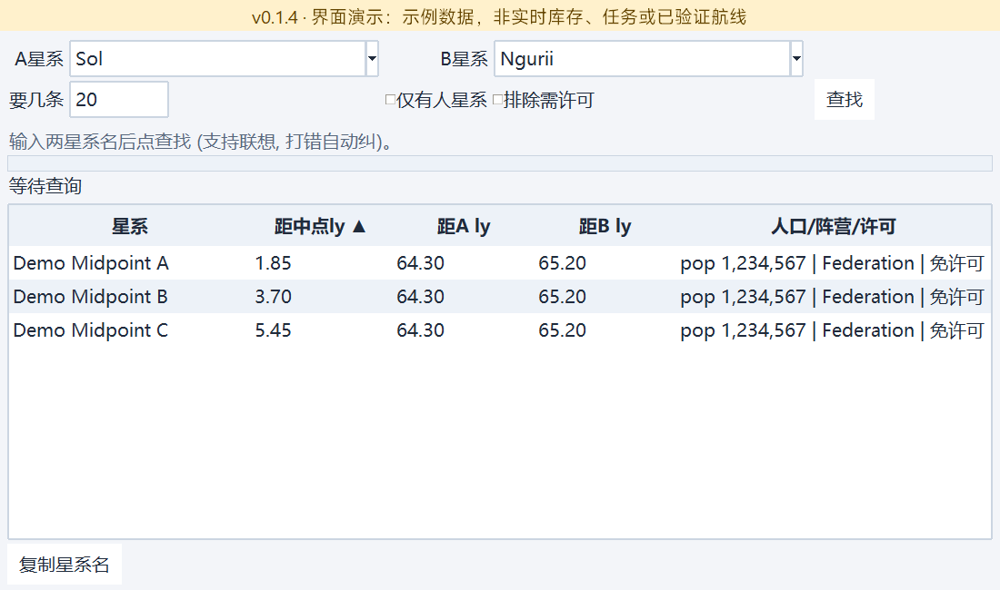

</details>

## 如何理解查询结果

### 满配件范围与首次扫描

- **首次扫描会很慢，可能数分钟到十多分钟。** 首次及手动更新固定采集 Sol 周围 **20,000 ly** 最宽松站点名单，主要适用于 Bubble。
- 后续改条件复用本地库存；换参考星系仅补查缺少的坐标并重算距离。扩大半径不会自动发现名单外站点，远离 Bubble 可能无有效结果。
- 折扣、AX、通用多功能无人机控制器 7A／7C 和 Merc 默认不要求。Merc 身份仍有歧义，严格条件可能零命中，不会按猜测放行。
- 快照成功更新后原位覆盖；失败保留旧数据。库存不是实时数据，界面显示缓存年龄。
- 装备目录与库存是两套数据：支持手动 GitHub 清单更新／回退，但**首份清单 Release 尚未发布**；更新目录后还需手动刷新库存才应用新目录。
- “满配件”相对于当前目录及勾选条件；机库／车库等明确排除项见[工具说明](docs/full-outfitting.md)和[后续清单计划](docs/catalog-next-version.md)。

详见：[完整用法与验证记录](docs/full-outfitting.md) · [清单更新及回退](docs/catalog-updates.md)。

### 使用时需要区分

- **折扣**：普通筛选按已知公共规则判断，不凭关联 Power 推定。工程师采购选择 Power 后另行明示适用武器的满级个人优惠假设，未读取玩家实际等级；选择“无”只算公共优惠。不叠加折扣。详见[折扣规则](docs/station-discounts.md)和[工程师采购](docs/engineer-shopping.md)。
- **距离**：海盗任务配对的半径针对来源；扩展 RES 星系行针对目标。半径 `0` 为不限，站点／星环最大 Ls 留空才不限，填 `0` 是实际 0 Ls 上限。完整规则见[检索逻辑](docs/README_检索逻辑.md)。
- **估算不等于路线**：工程师额外跳数只是估算；稀有商品中子顺路筛选只检查几何关系，不验证燃油、落点或实际省跳。
- **殖民限制**：当前无站点检查仍包含普通航母，会排除只有航母的星系；不支持建设槽位数量筛选。最近有人默认人口 >1，最近距离上下限针对同一个最近达标星系。
- **中子规划器已拆分**：完整航线规划请使用 [Elite_dangerous_Neutron_Planner](https://github.com/kxdxzr/Elite_dangerous_Neutron_Planner)。本 EXE 不再内置；旧 `route_ship_favorites.json` 可手动导入独立版。稀有商品几何筛选仍保留。

## 数据、会话与导出

- **数据不保证实时或穷尽银河。** 库存、许可、折扣、任务、空位和殖民资格都需在游戏内核实。派系数量只是潜在任务发布者估计；星环不能证明具体 RES 类型。
- 页数／服务端上限、数据缺失、请求失败或停止可能导致未完成；“无结果”不代表游戏内不存在。进度百分比仅对应标注的当前阶段。
- 稀有商品使用关联 Power；Spansh `Unoccupied` 与 Inara Unoccupied／Expansion／Contested 的合并对应关系未经样本验证，后两者不能独立筛选。
- 变更每 1.5 秒及关窗时保存，保留语言、外观、条件草稿和七个工具设置；原子写入，关窗保存失败时提示并保留窗口。
- EXE 数据在 `%LOCALAPPDATA%\EliteDangerousFilter\`；源码运行使用项目 `data/` 与 `cache/`。`ELITE_FILTER_DATA_DIR` 可统一指定隔离目录。旧数据可用 `scripts/migrate_data.py` 迁移，已有目标不覆盖。
- CSV 开头为五行 `# `来源信息：作者、项目名、运行版本、含时区导出时间、项目链接。部分导出（如满配件工具）还附检索条件，随后为空行、表头和结果；**导入时不要固定跳过六行，应定位元信息后的空行／结果表头**。
- CSV 保留已完成搜索的条件，而不是尚未重新查询的界面草稿；主界面按条件拆列，不导出整份原始 JSON。来源信息标识软件，不代表拥有第三方游戏数据版权。

## 源码运行与构建

源码需要 **Python 3.10+ 和 tkinter**，无第三方运行依赖。`python -m tkinter` 可检查 Tk；Debian／Ubuntu 可能需要安装 `python3-tk`。

```sh
git clone https://github.com/kxdxzr/Elite_dangerous_Filter.git
cd Elite_dangerous_Filter
python filter_gui.py
```

在项目目录执行测试及 Windows 打包：

```sh
python scripts/run_tests.py
python -m compileall -q src tests scripts filter_gui.py spansh_filter.py
python -m pip install -r requirements-build.txt
python -m PyInstaller --noconfirm --clean EliteDangerousFilter.spec
```

默认输出为项目下的 **`dist/EliteDangerousFilter.exe`**；程序身份及版本只在 `src/app_metadata.py` 维护，构建时从与CSV相同的数据派生Windows版本资源，无需另改版本文件。版本资源不是代码签名。

实际 EXE 支持 `--smoke-test <报告.json>`、`--session-test write <报告.json>`、`--session-test read <另一报告.json>`；会话写入／读取须分进程运行，设置独立 `ELITE_FILTER_DATA_DIR`，提前创建报告目录，避免覆盖个人会话。Tk 测试需要图形环境；CI 覆盖 Windows／Ubuntu、Python 3.10／3.13。

实现位于 `src/`，测试在 `tests/`，脚本在 `scripts/`，条件示例在 `examples/`。CLI 用法见 `python spansh_filter.py --help` 及[筛选器说明](docs/README_筛选器说明.txt)。截图重拍使用 `scripts/capture_screenshots.py` 和可选开发依赖 Pillow 12；脚本隔离会话并禁用网络，[manifest](docs/images/screenshots.json)记录尺寸与哈希。

功能封面可用 `python scripts/render_feature_cover.py` 重新生成（需要 Pillow 和支持中文的字体），输出英文 `docs/social-preview.png` 和中文 `docs/social-preview-zh.png`，不联网或读取程序数据。README 直接引用这些图片；GitHub 仓库的社交预览设置须另外上传所选图片，不会随文件修改自动更新。

## 文档与数据来源

- [详细检索逻辑](docs/README_检索逻辑.md) · [满配件工具](docs/full-outfitting.md) · [工程师采购](docs/engineer-shopping.md) · [折扣规则](docs/station-discounts.md)
- [语言包结构与扩展说明](docs/localization.md)（目前仅启用中英文）
- [v0.1.4发布说明](docs/releases/v0.1.4.md) · [历史发行版本](https://github.com/kxdxzr/Elite_dangerous_Filter/releases)
- 开发其他 ED 工具：[公开数据源速查（可独立分享）](docs/ed-public-data-api-reference.md) · [完整 API 开发参考](docs/ed-api-reference.md)
- [Spansh](https://spansh.co.uk/)：星系、站点、派系与天体数据；[EDSM](https://www.edsm.net/)：坐标与同市场配件身份补证。
- [EDTools／CMDR VicTic](https://edtools.cc/pve.php)：任务配对与明确 RES／CNB 地点记录，非实时任务 API；[Inara](https://inara.cz/elite/)：稀有商品目标模板参考。

## 许可与致谢

Copyright (c) 2026 kxdxzr。项目自身代码及文档自许可变更声明提交起采用 [GPL-3.0-only](LICENSE)，允许商用；分发须遵守对应源码、许可声明等义务，不提供担保。此前 MIT 副本的授权不撤销（包括提交 `afe84c4`、`2393198`），历史版本未被追溯重新授权；第三方代码、数据及接口保留各自许可与条款。

项目由 **GPT-6.1 Sol** 通过 **vibe coding** 开发并随用户需求迭代。社区项目，与 Frontier Developments 无隶属关系。
