# Elite_dangerous_Filter

[English](README.md) · [简体中文](README_zh-CN.md) · [发行版本 / Releases](https://github.com/kxdxzr/Elite_dangerous_Filter/releases)

[详细检索逻辑与工具规则](docs/README_检索逻辑.md)

基于 [Spansh](https://spansh.co.uk/) 数据的 Elite Dangerous 星系与空间站筛选工具，使用 Python / tkinter，支持即时中英文切换。

**单个 Windows EXE 内含七个内置工具——无需安装 Python，也无需 API key：**

- **通用筛选：** 可自由组合的星系／空间站条件（行之间 AND、同一行多选为 OR）、距离交集／范围外、模块等级／级别匹配、船厂／改装数据新鲜度及殖民候选条件——Spansh 自带表单无法表达的复杂查询。
- **中子星跳跃规划器：** 导入 Coriolis JSON／EDSY SLEF 配船，按实际船型计算燃油与补油，支持有序途经点。
- **工程师途中采购：** 顺路找到一座能一次买齐完整清单的站点，目的地来自 25 位舰船工程师。
- **稀有商品目标查找：** 142 个来源、138 个星系，可选实验性中子顺路排序。
- **另有** 海盗任务候选（测试中）、航母车位与两系中点查找。

[**下载 Windows EXE v0.1.3**](https://github.com/kxdxzr/Elite_dangerous_Filter/releases/download/v0.1.3/EliteDangerousFilter.exe) · [v0.1.3 发布说明](docs/releases/v0.1.3.md) · [所有版本](https://github.com/kxdxzr/Elite_dangerous_Filter/releases)

**UI 重构 Beta：**[下载 v0.1.4-beta.1](https://github.com/kxdxzr/Elite_dangerous_Filter/releases/tag/v0.1.4-beta.1) · [Beta 发布说明](docs/releases/v0.1.4-beta.1.md)。**预发布，不保证没有潜在 Bug，可能存在回归问题。** 测试前请备份 `%LOCALAPPDATA%\EliteDangerousFilter`，Beta 与稳定版共用数据目录。v0.1.3 仍为最新稳定版。

Windows 64 位单文件程序，双击 `EliteDangerousFilter.exe` 即可使用，无需安装 Python。实际查询需要联网，无需 API key。EXE 未做代码签名，首次运行可能弹出 SmartScreen 警告：选择 **更多信息 → 仍要运行**，或用发布页的 `SHA256SUMS.txt` 校验文件（`certutil -hashfile EliteDangerousFilter.exe SHA256`）。

从源码运行需要 **Python 3.10+ 和 tkinter**，没有第三方运行依赖：

```sh
git clone https://github.com/kxdxzr/Elite_dangerous_Filter.git
cd Elite_dangerous_Filter
python filter_gui.py
```

可运行 `python -m tkinter` 检查 Tk。Debian / Ubuntu 可先安装 `sudo apt install python3-tk`。

主界面右侧选择 **中文 / English**，即时切换主界面及辅助窗口。游戏中的星系、派系、船和模块名称保持原文；切换语言不会改变查询条件。

**v0.1.4-beta.1（预发布）：**顶部的 **外观** 可选 **跟随系统／浅色／深色**。默认跟随系统，运行中跟随 Windows 的应用颜色设置；不支持的系统回退到浅色。选择随会话保存，已打开及新建的工具窗口、表格、下拉列表与文本输入区统一切换。同时调整字体、间距、表格交替行底色和主要搜索按钮。原生文件选择／系统对话框保留系统外观，标题栏颜色视 Windows 支持情况而定。检索规则、结果排序、CSV 顺序及有序途经点均不改变。稳定版 v0.1.3 EXE 不包含本次 UI 改动。

仓库：[kxdxzr/Elite_dangerous_Filter](https://github.com/kxdxzr/Elite_dangerous_Filter)。项目由 **GPT-6.1 Sol** 通过 **vibe coding** 完成，并根据用户需求持续迭代。

> **项目定位：** 不一定比 Inara 更好用，但提供更全面、更灵活、可自由组合的筛选条件，适合作为复杂检索的补充，而不是替代常用查询。

> **v0.1.3：工程师采购清单、已知折扣、成对规格、表头排序与中子星规划器均已包含在Windows EXE中。** [发布说明](docs/releases/v0.1.3.md)。海盗查找仍在测试中；库存、折扣、许可与实际航线请在游戏内核实。

## v0.1.3 新增

**结果表头排序（v0.1.3）：**点击表头切换升／降序，数字按数值、时间考虑时区、名称按自然顺序，未知始终在末尾。切换语言／分批载入保留排序，复制仍对应原记录；不改变内部航线，有序途经点编辑器不启用排序，航线CSV仍按实际顺序输出。

**工程师采购清单：**可添加／删除多项模组或舰载武器，每项独立设置规格、折扣和新鲜度。候选站必须**同时满足全部采购项**，同一行多选名称也要求全部有货；普通主窗口的“属于其一”仍为OR。完整清单及草稿随会话保存，结果／CSV按采购项分列展示证据。不核查购买数量，也不规划分多站凑单。

**模组／武器规格修复（v0.1.3）：**单栏“规格”列出全部153种内置名称的已确认组合，例如Plasma Accelerator的**2C／3B／4A**，不再任意拼接等级和级别。学习／缓存保留对应关系；旧条件仍有效，未收录规格可手填查询，离线建议不保证穷尽实时库存。

**[工程师途中采购](docs/engineer-shopping.md)（v0.1.3）：**目的地从25位舰船工程师星系选择，寻找途中可同站满足完整采购清单的售卖点。每项独立规格、折扣、新鲜度；自定航程，自动多跳估算，可限制额外估算跳数及到站`ls`，忽略航母／地面采购站。默认80 ly、最多额外1跳、到站小于1500 ls、要求折扣、忽略航母、允许地面采购站，均可修改。清单／草稿随会话保存，界面与CSV按项展示证据。排序仅覆盖已取回结果；不核查数量、不规划分站凑单，**估算跳数并非已验证航线**。

**主界面分类与结果（v0.1.3）：**普通条件先选分类，模组先选槽位类型，再选名称。分类不改变筛选语义、不清空名称；会话保存草稿，条件文件保留槽位。结果／CSV按条件拆分距离、名称／等级／级别、优惠幅度和来源，列多可横向滚动，不再堆入“关键信息”。

**舰船／模组折扣：**“是否打折”仅有“**不限／是**”（属于其一、等于、包含）。按[已知地点／势力公共优惠规则](docs/station-discounts.md)判断，不下载标准价格表，也不凭关联 Power 猜折扣。同一件商品须同时满足名称、模组规格及适用规则；Li Yong-Rui 要求实际控制势力与 Fortified／Stronghold 状态。特定站点、特定舰船／模组的优惠分别判断；规则未确认／证据缺失为未知，不冒充原价。“优惠幅度 %”表示减价比例（15 即减价15%、85折），界面及 CSV 均与“折扣来源”分列。不计个人等级／效忠奖励、过期社区目标或未经确认的优惠叠加；库存、许可和最终结算价以游戏内为准。

## 功能

- **殖民候选星系查找器（v0.1.2 新增）**：强制零人口、无站点、无需许可。区域半径与距最近人口达标星系的距离上下限分别可选，星系价值也可选；支持星球与独立星环条件组（全部／任一存在）、卫星关系和互绕成员推定。详见 [v0.1.2 发布说明](docs/releases/v0.1.2.md)。
- **v0.1.2 主界面扩展**：星系普通行新增站点／航母／派系数量；通过 **天体／最近有人条件** 添加嵌套星球／星环组及带可编辑人口门槛的最近距离范围。与普通条件组合，不附带殖民限制；详见 [详细规则](docs/README_检索逻辑.md)。
- **通用筛选**：星系／空间站查询，重复条件组合；同一行多选为 OR，不同行为 AND。
- **距离与模块**：多参考点距离交集／范围外查询，同件模块等级／级别匹配，以及船厂／改装数据新鲜度条件。
- **航母车位查找**：最多 50 ly，按 Spansh 已收录的航母站点类型直接计数来筛选停车候选星系，支持含边界的最少／最多航母数量筛选，类型数据不完整显示未知；数量不代表实时空位。
- **稀有商品目标查找**：142 个来源条目、138 个星系，默认 Ngurii，目标范围默认 200–220 ly。指定关联 Power 或扫描全 12 个势力，要求大型坪，排除地面站、航母、殖民船；各势力先查 ≤100 Ls，完整检索无结果后才放宽到 ≤1000 Ls。同星系仅算一个结果，保留最近合格站点供参考，按 ly、Ls 排序各显示前 5 个星系；汇总不计空间站数量。
- **海盗任务候选查找（测试中）**：EDTools 配对与地点记录，叠加 Spansh 小派系、数量、控制 Power、来源站与目标星环距离条件。
- **辅助操作**：两系中点、停止、检索诊断、表头排序、CSV导出、条件保存／加载，以及主界面和所有工具窗口的会话恢复。

## 既有工具与使用方法（v0.1.2引入）

### 殖民候选星系查找器

打开 **额外功能 → 殖民候选星系查找器**。此工具已包含在 Windows EXE 中，不是仅源码预览。

| 设置 | 使用方法 |
| --- | --- |
| 区域参考星系／半径 | 可选，限定参考星系周围的候选范围 |
| 最近有人星系最小／最大 ly | 独立限定距最近人口 **>1** 星系的距离；支持只填一侧上下限 |
| 星系价值 | 可选，要求严格大于填写的阈值；可选测绘、扫描或地标价值字段 |
| 星球条件组 | 添加类型、可着陆、可地球化、材料、信号、轨道属性等条件 |
| 独立星环条件组 | 独立要求星环，不必属于星球组匹配到的星球 |
| 条件组组合 | AND 要求每组存在匹配；OR 要求任一组存在匹配。组内条件必须由同一星球／星环满足 |

例如：区域参考填 **Sol**、半径 **80 ly**，最近有人距离填 **4–6 ly**。两套距离条件同时生效，最近达标星系本身必须在 4–6 ly；若最近的只有 2 ly，即使另有一个在 5 ly 也不通过。这是参数示例，不保证当前一定有结果。

结果展示候选星系、所选价值、已启用的距离、最近有人星系、匹配星球／星环及推定天体关系。支持复制星系名、CSV 导出、停止、强制刷新与草稿恢复。卫星／互绕关系依据已记录的父级和轨道数据推定，不代表游戏内独立确认。

**v0.1.2 更新版 EXE 新增：** 结果新增扫描价值前三名星球列，按 `estimated_scan_value` 降序显示名称、类型和估算价格（Cr），不含恒星，不用测绘价值或首次发现奖励代替。已知星球不足三颗不补零，数据不完整时注明仅按已知估值排名；CSV 同步导出。复用已有天体摘要／完整记录，不为展示价格增加额外查询。

**v0.1.2 已知限制：** 当前强制零人口、明确免许可、无站点，且仍把**舰队航母算入排除范围**，会误排除只有航母的星系；忽略普通航母是待修正事项，当前 EXE 尚未实现。第三方检查不保证星系尚未被认领或一定可以认领。本版本不包含建设槽位数量筛选。

### 主界面星系筛选扩展

将主界面查询类型切换为 **systems**：

- 普通条件行新增站点总数（含航母）、航母数量、小派系总数、联邦／帝国／联盟派系数量，以及排除无政府派系的潜在任务派系数量（总数／联邦／帝国）。
- 点击 **＋天体／最近有人条件**，添加星球组、独立星环组及最近有人距离上下限。这里的人口门槛可以修改，默认是**人口 >1**。
- 详细条件与普通条件行以 AND 组合，不附带零人口、无站点等殖民准入限制；支持条件文件、草稿、诊断和完整原始数据 CSV 导出。

### 航母车位查找更新

保留工具名称。新增可选的**最少／最多航母数**，包含边界；留空不限，最多填 **0** 筛选确认零航母的记录。按 Spansh 航母类型记录直接计数，不再按站点总数推测车位。数量未知不通过已启用的数量范围筛选；结果不代表实时空位。

完整规则见 [检索逻辑](docs/README_检索逻辑.md) 和 [v0.1.3 发布说明](docs/releases/v0.1.3.md)。下方截图已覆盖当前主界面及全部七个内置工具。

**v0.1.2 更新版格式调整：** 主界面和所有工具的 ly 距离结果固定两位小数；人口显示整数，大数字每三位加逗号，例如 `1,234.50 ly`、人口 `1,234,567`、价值 `55,000 Cr`。主界面 CSV 导出名称、星系及本次搜索条件对应的实际值，各参考星系距离独立成列，不再导出整份原始 JSON。搜索后仅修改条件而未重查，不影响已有结果的导出列。航线 CSV 移除每行重复的内部完成、失败分段及状态列，未完成航线的导出确认保留。

所有结果表、CSV 距离列及命令行文本中的到站距离 Ls 同样固定两位小数，例如 `1,279.41 Ls`；缺失距离仍为未知，不显示成 `0.00`，不影响 Ls 筛选比较精度。

**v0.1.2 更新版分页调整：** 殖民查找器移除“最大页数”，自动翻页直到达到**最多结果**、读完数据源候选或手动停止；忽略旧会话保存的页数限制。不限定区域且条件严格时可能查询较久，保留停止及重复页／错误检测。其他工具的页数设置不变。

**v0.1.2 更新版最近星系信息：** 结果列改名为**最近有人星系**，移除人口数量列，新增复制最近有人星系按钮。表格及 CSV 标注该星系固定站点的最大停机坪（S／M／L），不计航母及殖民船，缺失时标为未知。复用同一最近星系记录，不额外请求，也不因停机坪大小改选更远星系。最近有人仍按人口 >1 判断，在启用最近距离上下限时查询。

**v0.1.2 更新版进度调整：** 主界面及所有工具在总量已知时展示真实的阶段计数和百分比（候选核查、站点复核、天体／星环批次或中点目标结果数）。百分比仅对应标注的当前阶段，不是整体耗时预测。网络准备及封顶／未知总量明确显示总量未知和已处理数，不将页数预算当成全库总量；停止、失败、未完成与完成分别显示。

稀有商品明细表与CSV移除重复的**范围**列，100 Ls／1000 Ls回退规则保留；v0.1.3进一步按星系合并目的地。v0.1.3继续作为稳定版，UI重构Beta下载入口见上方。

**v0.1.3同时包含：**殖民表格／CSV依次显示候选星系、扫描价值前三、最近有人星系、最近距离、最大停机坪等信息。主界面与各工具提供对应名称／星系／站点复制按钮；未选择或字段为空时提示，不清空原剪贴板，并保留双击快捷操作。

## 中子星跳跃规划器（v0.1.3已打包）

稀有商品中子筛选为**实验性功能**，一次查询复用同批候选，逐势力渐进放宽顺路条件（30°／10%额外绕行→45°／25%→60°／50%），首档有几何命中即停，投影须位于途中。40／50 ly模型仅作内部参考及同几何条件下的次要排序，不是准入门槛；模型未省跳或模型提示不可用均不排除顺路候选。显示档位、参考中子星、夹角和绕行，不显示跳数或落点，不保证实际省跳或全势力有结果。

稀有商品查找器提供可选的 **顺路中子星辅助目标查找**：仅使用**所选商品来源星系**（默认 Ngurii）**200 ly 内、到达距离≤100 Ls** 的中子星，按几何条件决定候选，不依赖固定40／50 ly提示的省跳结果。不验证普通中转星、燃油或飞行时间，参考中子星不代表已确认增压收益。详见[筛选规则](docs/route-planner.md#稀有商品目的地筛选)。

从主界面打开 **中子星跳跃规划器**，默认启用中子增压。使用Spansh exact-plotter后端按配船计算燃油与补油，不是简化的固定跳距中子路线接口；已包含在可下载的v0.1.3 EXE中。

- **舰船配置收藏：** 粘贴／导入单个 Coriolis JSON 或 EDSY SLEF，命名后本地选择、编辑、重命名、删除。不增加航线收藏库或账号系统。以原子写入保存到程序数据目录的 `route_ship_favorites.json`，不上传 Git。
- **所选舰船预览：** 仅显示船型、舰名、普通及中子增压后的理论满油跳距，不显示编号、倍率或 FSD 技术参数。修改货物质量会重新计算；假设主／副油箱满油且不使用注入，不保证附近有中子星，也不代替实际路线的储备燃油等限制。缺失或不支持的参数明确提示，不猜测。
- **联网计算：** 将选中的配船和航点发送至 Spansh。首次解析下载固定版本的 EDCD/coriolis-data FSD 数据并本地缓存；未知 FSD／舰船参数明确报错，不猜测。特殊配置优先使用 EDSY SLEF。
- **有序途经点：** 支持添加、删除、上移、下移。每段按**起点主油箱满油**独立规划，不继承前段剩余燃油或增压状态；“第一段已增压”只用于首段。多段提交前必须确认，途经点**不保证能够补油**。
- **结果／CSV：** 展示星系、分段、ly 距离、燃油、补油／中子／注入及途经点标记。合并共享端点，但分别保留前段到达剩余燃油、后段假定出发燃油；每段起点都标注满油提醒。可复制星系名、导出 CSV；部分结果需确认导出，并明确保留未完成状态。
- **进度／停止：** 显示已完成分段，不伪造服务器计算百分比。停止后不再轮询或提交后段，不保证撤销服务器已有任务；仅保留已验证的完整前段，失败／超时不自动重提。

完整说明见 [航线规则与限制](docs/route-planner.md#中文)。使用独立本地界面，不自动操作浏览器，也不复制网站图形。

## 海盗任务查找（测试中）

打开 **额外功能 → 海盗任务查找器**。所有启用条件都为 AND：

| 条件 | 规则 |
| --- | --- |
| 参考星系／半径 ly | 限制**任务来源到参考点**的距离，不是来源到目标距离；`0` 为不限距离，参考点仍用于排序 |
| 最少任务／联邦／帝国派系 | 独立最少数量条件，均为 `0–8`；`0` 不限制，非零时估计 Spansh 非 Anarchy 潜在任务派系 |
| 来源存在派系 | 来源有指定派系，不要求该派系控制来源 |
| 来源／目标控制小派系 | 完整名称精确匹配，不区分大小写；名称联想不自动改写输入 |
| 控制 Power | 使用 `controlling_power`，可作用于来源、目标或双方；不是关联 `power` |
| 来源停机坪 | 留空不限，S／M／L 为船型需求；大坪兼容小船 |
| 来源空间站最大距离 Ls | 留空不限；与停机坪条件必须由**同一座有 Missions 服务的站点**满足，包含地面站，排除航母／Stronghold Carrier／殖民船 |
| 目标星环最大距离 Ls | 留空不限；最近已知有环天体的到达距离，不是环半径或具体 RES 位置 |
| 优先 RES Low | 明确 Low 优先，不强制要求 Low，也不凭星环臆造 Low |
| CNB 回退 | 完整检索后，没有符合条件的明确／推定 RES，也没有地点未知候选，才显示 CNB；错误或停止时不回退 |

**注意距离单位：** 半径 `0` 为不限；站点／星环距离留空才不限，填 `0` 表示上限为 **0 Ls**，上限包含边界。

- 有环标为 **RES（星环推定）**；无地点资料标为 **情况未知**，不把未知当作没有 RES。启用距离条件后，无法确认距离的记录不计为符合条件，并显示未知／未完成诊断。
- ≤250 ly 使用 EDTools 的明确 `/pve.php` 网页；半径 `0` 或 >250 ly 使用公开 `pve.json`、`res.json` 并按坐标计算距离。完整仅指已收录数据集，不是整个银河；页面参考点、范围、表结构和行数均校验。
- **导入 PvE 网页** 可使用浏览器保存的 HTML；导入范围不足会拒绝。仅地点／半径条件且参考名一致时可离线，其余条件按需访问 Spansh。
- **复制任务来源星系** 与 **复制目标星系** 分别复制选中行；双击仍复制目标。来源站及星环字段包含在结果和 CSV 中。
- 控制派系与 Power 批量预筛、详情复用；Power 使用 gzip 和最多 4 页并发。完整天体数据批量查询星环，避免用不含星环的摘要判定无环。进度节流、每批 200 行绘表，不截断实际结果。
- EDTools 缓存 1 小时，Spansh 详情／控制列表／星环距离缓存 5 分钟。**刷新数据并查询** 切换在线并强制刷新所需数据；失败不静默使用过期缓存。目标 Power 叠加来源条件时仍可能需要补查来源详情。

本机实测 `Sol / 无限 / 最少派系 3 / Yuri Grom / 来源`：强制刷新约 15.37 秒，紧接着缓存复查约 0.19 秒，结果一致。网络及数据变化会影响耗时，不能作为固定性能保证。完整规则和案例见 [检索逻辑](docs/README_检索逻辑.md)。

## 会话、数据与限制

- 每1.5秒及关闭窗口时保存变更；兼容旧会话，保留未完成主条件草稿、语言和七个工具参数。原子写入，关闭时保存失败会提示并保留窗口。
- EXE 数据目录仍为 `%LOCALAPPDATA%\EliteDangerousFilter\`。源码运行将会话／舰船收藏保存到 `data/`，运行缓存保存到 `cache/`；`ELITE_FILTER_DATA_DIR` 仍可将两者统一覆盖到隔离目录。旧根目录文件在访问时迁移，也可用 `python scripts/migrate_data.py` 一次迁移全部已知运行文件；目标已存在时绝不覆盖，保留两份并报告冲突。个人数据、缓存和 CSV 均不上传仓库。
- 数据不是实时任务、库存或空位。派系数量只估计潜在任务发布者，需要游戏内确认 BGS、声望和任务。
- 稀有商品工具使用关联 Power，暂以 Spansh `Unoccupied` 作为 Inara Unoccupied / Expansion / Contested 的合并候选；对应关系尚未样本验证，不能分别筛选后两者。
- 分页计数可能封顶；达到上限、重复页、缺关键数据、请求失败或停止时，明确区分未完成与无结果。

## 开发与验证

```sh
python scripts/run_tests.py
python -m compileall -q src tests scripts filter_gui.py spansh_filter.py
python -m pip install -r requirements-build.txt
python -m PyInstaller --noconfirm --clean EliteDangerousFilter.spec
```

自动化测试覆盖引擎、会话、本地化、PvE 与殖民条件／数据完整性／缓存／并发及真实 GUI 操作。Tk 测试需要图形环境；Linux 无 DISPLAY 时跳过 GUI 测试。GitHub Actions 测试 Windows / Ubuntu、Python 3.10 / 3.13。

构建输出 `dist/EliteDangerousFilter.exe`。隔离目录中使用 `--smoke-test <报告.json>` 验证七个工具窗口和中英文加载；分别运行 `--session-test write <报告.json>` 与 `--session-test read <另一报告.json>` 验证跨进程恢复。会话测试必须设置独立 `ELITE_FILTER_DATA_DIR`；报告目录须存在。

CLI 示例：`python spansh_filter.py --help`；参数说明见 [筛选器说明](docs/README_筛选器说明.txt)。根目录入口保留原启动命令，实际代码在 `src/`，测试在 `tests/`，辅助脚本在 `scripts/`，示例条件在 `examples/`，详细文档／截图在 `docs/`。例如：`python spansh_filter.py --kind stations --ref-system Sol --filters-file examples/ex_station_hitech.json`。根目录 `python -m unittest discover -v` 仍然有效。EXE 自检模块由程序通过 `--smoke-test`／`--session-test` 加载，因此保留在 `src/`。

## 截图

以下截图于**2026-10-18使用v0.1.4-beta.1界面（浅色外观）重新拍摄**，覆盖主窗口、星系详细条件编辑器及**全部七个内置工具**。均为实际应用窗口，填入**离线演示数据**，顶部黄色横幅明确标注；不代表实时库存、任务、可殖民星系或已验证航线。必要时加宽窗口以展示控件，点击图片可查看原尺寸。稳定版v0.1.3界面与此不同。[英文截图](README.md#screenshots)。

[主界面](#主界面) · [稀有商品](#稀有商品目标查找器) · [海盗任务](#海盗任务查找器测试中) · [航母车位](#航母车位查找器) · [两系中点](#两系中点工具) · [殖民候选](#殖民候选星系查找器-1) · [中子规划](#中子星跳跃规划器) · [工程师采购](#工程师途中采购)

### 主界面

展示条件分类、槽位分类、单栏成对规格、折扣条件和独立结果列；名称表头的箭头表示排序方向。

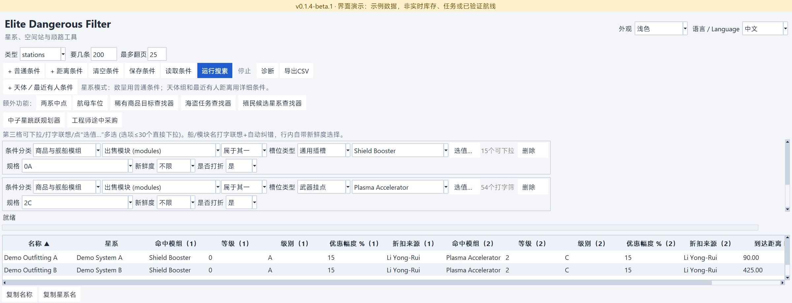

<details>
<summary>星球／独立星环组及最近有人星系条件</summary>


</details>

### 稀有商品目标查找器

展示来源、势力筛选、可选的实验性中子顺路条件，以及按星系合并的结果和参考中子星列。

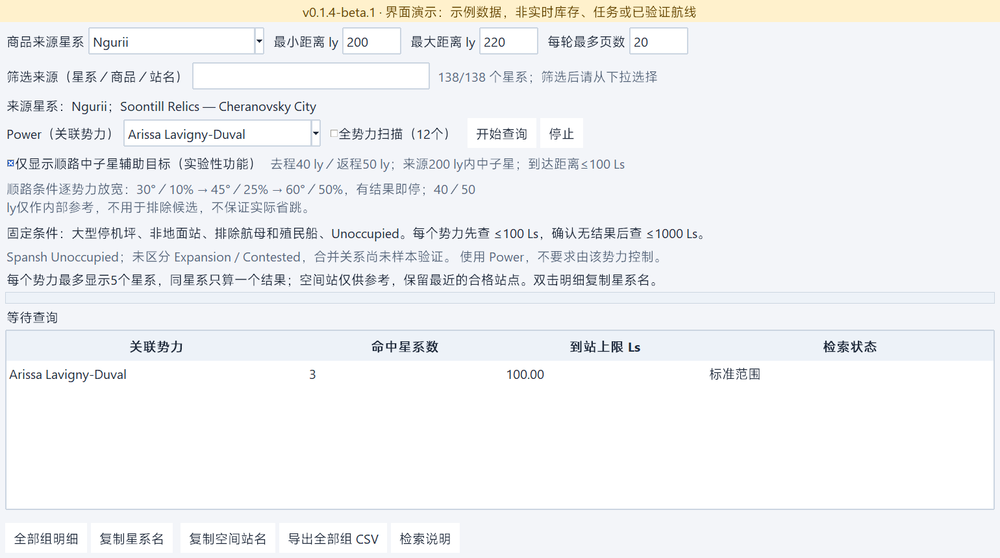

### 海盗任务查找器（测试中）

同一查询的两种视图：先展示结果概览，再将表格向右滚动展示匹配来源站及目标星环距离。

**结果概览**

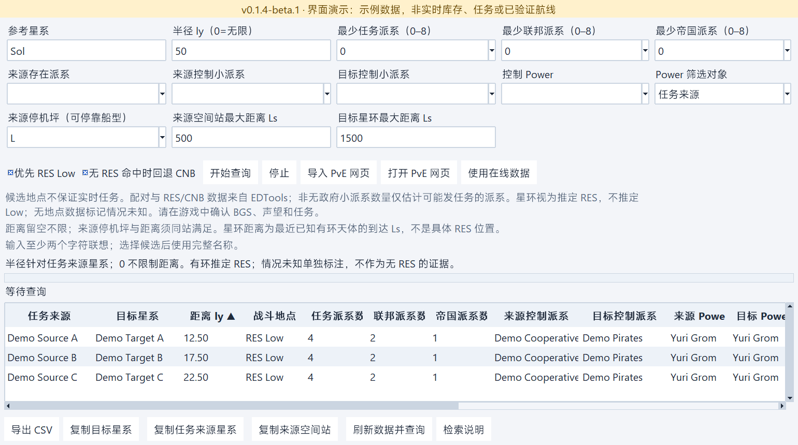

**站点及星环距离明细**

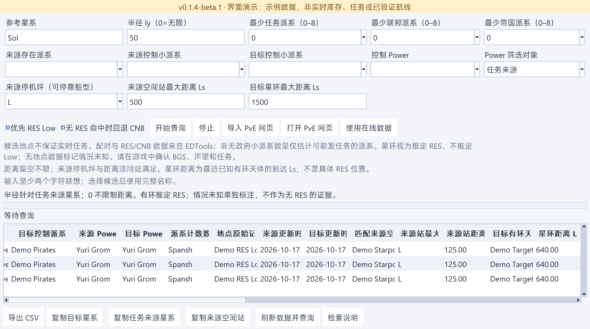

### 航母车位查找器

当前版本的航母数量上下限和可排序统计列，替换旧版车位估计界面；记录数量不等于实时空位。

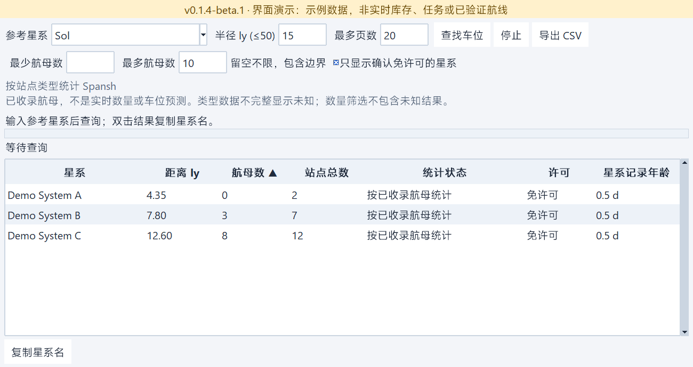

### 两系中点工具

展示两系中点的查询配置，以及距中点、距两端的示例结果列。

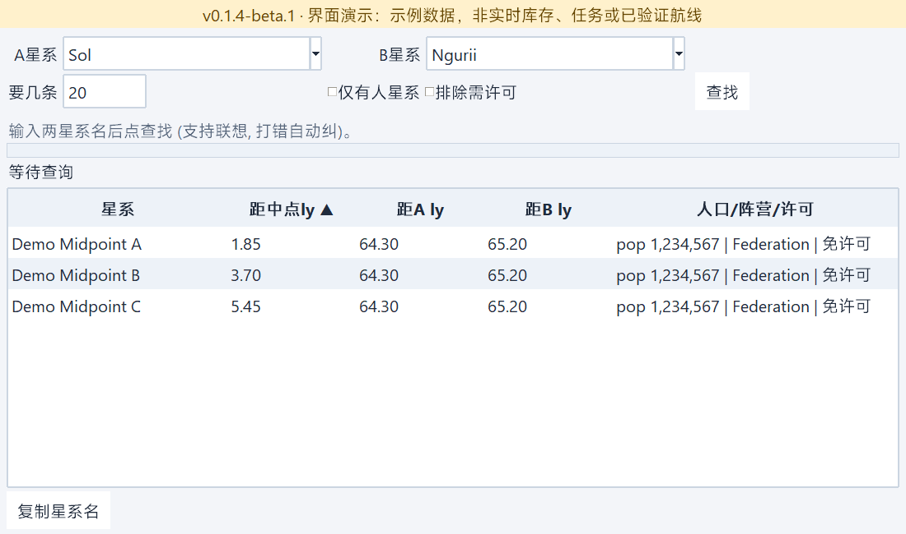

### 殖民候选星系查找器

展示独立区域／最近有人距离、星球条件组、扫描价值前三名和邻近有人星系信息。

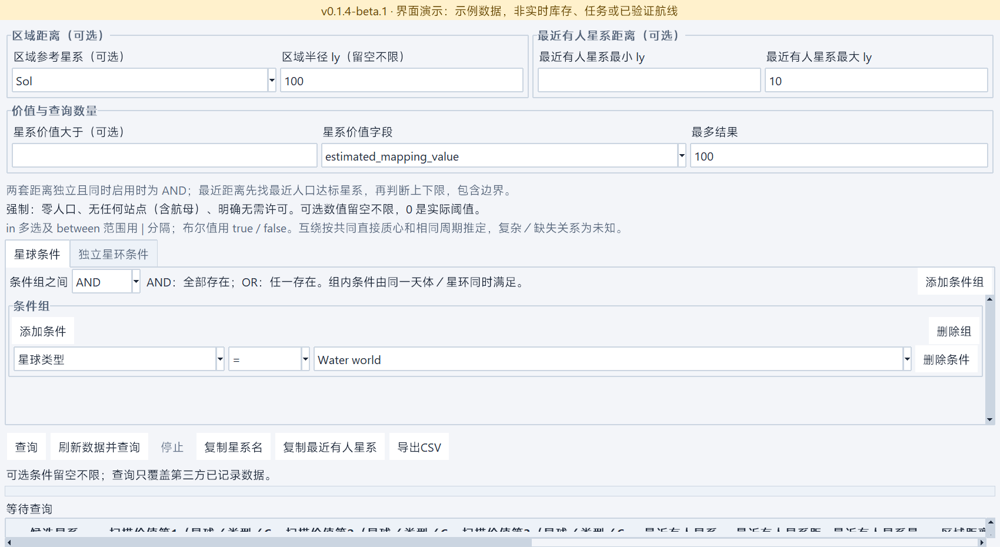

<details>
<summary>结果向右滚动：价值与天体匹配证据</summary>

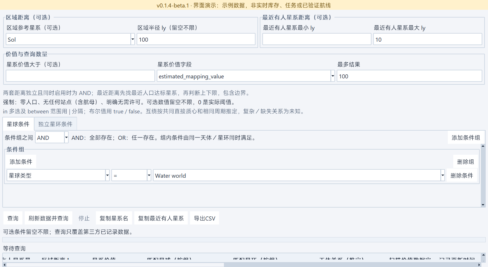

</details>

### 中子星跳跃规划器

展示示例舰船收藏、理论跳距、有序途经点、规划选项和分段结果；图中航线为演示记录，不是实际规划结果。

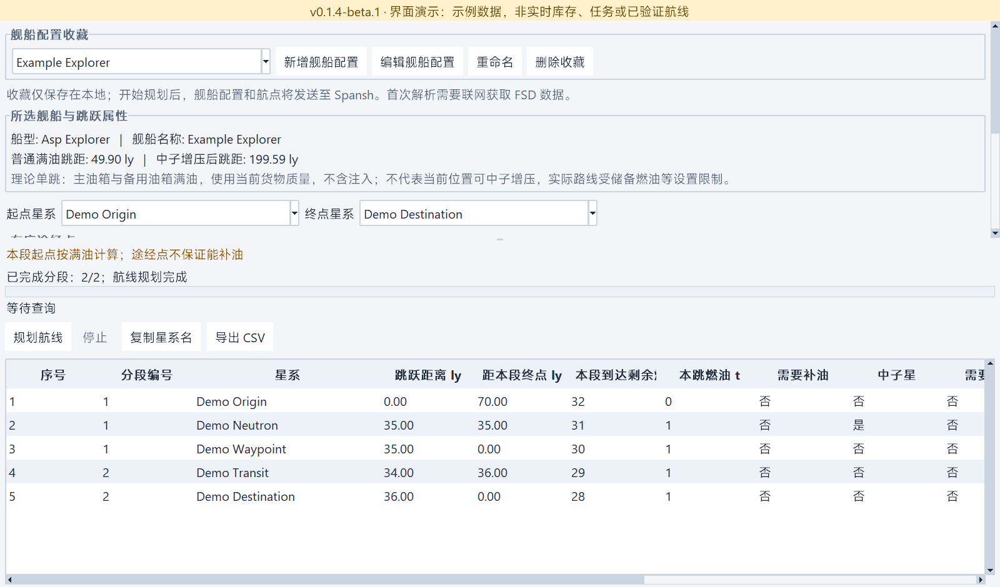

### 工程师途中采购

展示多项独立规格采购清单、工程师目的地、自定航程、额外跳数限制、忽略航母／地面站和逐项折扣证据。

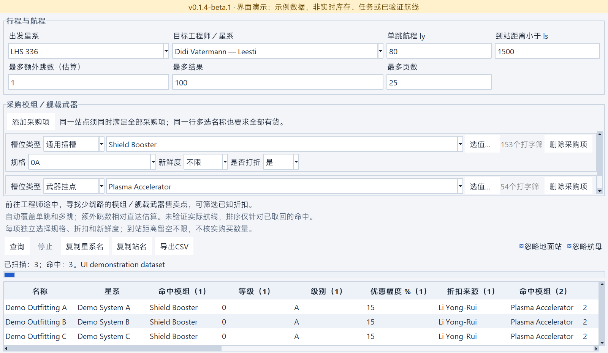

<details>
<summary>结果向右滚动：距离、估算跳数与绕行距离</summary>

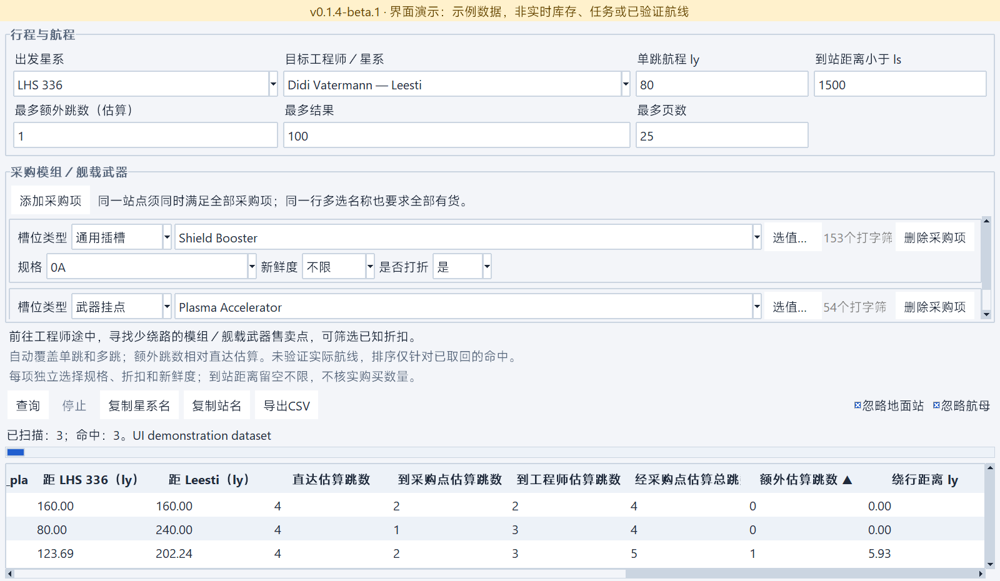

</details>

截图可在Windows使用可选开发依赖**Pillow 12**重拍：`python scripts/capture_screenshots.py`。脚本禁用网络、隔离会话，并在[screenshots.json](docs/images/screenshots.json)记录版本、尺寸及校验值；应用运行不需要Pillow。

截图展示UI重构Beta，而非旧版稳定EXE。各发行版分别提供对应附件的`SHA256SUMS.txt`；通过校验和测试不代表Beta没有潜在Bug。

## CSV 导出与来源信息

所有CSV导出顶部为5行以`# `开头的来源信息：作者kxdxzr、项目名、程序版本（本Beta为**0.1.4-beta.1**）、含时区导出时间和项目链接；随后空行、结果表头和数据。标签跟随界面语言，英文导出使用英文标签。主窗口按已完成搜索条件拆列，不再导出原始JSON。读取CSV须跳过5行来源及1个空行；来源标识软件而非上游游戏数据版权，已有CSV不会被修改。

## 数据来源

- [Spansh](https://spansh.co.uk/)：星系、站点、派系及完整天体数据。
- [EDSM](https://www.edsm.net/)：参考星系坐标。
- [EDTools / CMDR VicTic](https://edtools.cc/pve.php)：配对与明确 RES/CNB 地点记录，非实时任务 API。
- [Inara](https://inara.cz/elite/)：稀有商品目标模板参考。

## 许可

Copyright (c) 2026 kxdxzr。自引入本声明的提交起，本项目自身代码及文档采用 [GNU 通用公共许可证第 3 版（仅此版本）](LICENSE)（`GPL-3.0-only`）。允许商用；分发受许可覆盖的二进制程序或修改版时，必须遵守 GPL，包括提供对应源码及保留必要声明。本程序不提供任何担保，完整条款见 LICENSE。

本次变更不撤销此前已按 MIT 发布副本的授权（包括仓库提交 `afe84c4` 和 `2393198`）。既有发行标签及 EXE 附件未被替换，也未被追溯改为 GPL。第三方代码、游戏数据及接口内容仍受各自许可与条款约束，本声明不对其重新授权。

社区项目，与 Frontier Developments 无隶属关系。
